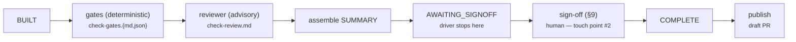

# Step 05 — Check: gates, reviewer, sign-off, and publish

← [04 Do](04-do.md) · [Index](README.md) · next: [06 Act →](06-act.md)

**Beat: Check.** The substance of the harness, and the biggest beat by far —
because Check isn't just gates and a reviewer. Per the model, **sign-off and
publish are steps of Check too**: gates and the reviewer run unattended
(**full** automation); sign-off is the human completing Check (**instrumented**
— touch point #2); publish is Check's closing work, turning an accepted bundle
into a contribution. One beat, four parts, only one of them human.



Two parts follow: [**how to use**](#how-to-use) it — the commands, and two
real worked examples (an unattended iterate round followed by an accept, and a
human reject) — then [**how it works**](#how-it-works) underneath: the 5/5/1
model, the leaves involved, gate mechanics, the reviewer's isolation sandbox,
SUMMARY assembly, the C6 accept-guard, and how a batch publishes as waves.

## How to use

### The gates run automatically

The gates you wired in [step 01](01-render-and-integrate.md) run as part of
`pdca flow` — nothing to type. Each emits a row: check, result, oracle, the rule
it belongs to, its evidence, and whether it's gating. Here is the real
`results/issue_779/check-gates.md`, from the round that was accepted:

```markdown
# Check gates — issue_779

**Overall (gating): pass**

The Check 5/5/1: 5 correctness · 5 conformance · 1 validation.

## Correctness (5)

| Check | Result | Oracle | Rule | Evidence | Gating |
|---|---|---|---|---|---|
| C1 Spec | none | brief.md | — | — | no |
| C2 Reproduction (red pre-fix) | none | (no gate configured) | — | — | no |
| C3 Change | none | patch.diff | — | — | no |
| C4 Wyrd gate: cargo xtask ci (fmt/clippy/build/test/deny/conformance) | pass | ./engine/xtask.sh ci | C4-ci | xtask ci: all checks passed | yes |
| C4 per-fix red->green: this patch's test red pre-fix, green post-fix | pass | ./engine/scripts/run-verify.sh | C4-verify | run-verify.sh: PASS — red without the fix, green with it (1 test(s) ran red). | no |
| C4 diff coverage: changed lines executed by the patch's tests | unverifiable | ./engine/scripts/run-diff-cov.sh | C4-diff-cov | the -p wyrd-server --test s3_server_version_header target executed 0 tests, so diff coverage was not measured | no |
| C5 surviving mutants on the bundle diff (cargo mutants --in-diff) | pass | scripts/mutants-in-diff | C5-mutants | 10 mutants tested in 2m: 8 caught, 2 unviable | no |

## Conformance (5)

| Check | Result | Oracle | Rule | Evidence | Gating |
|---|---|---|---|---|---|
| T1 Structure | none | (no gate configured) | — | — | no |
| T2 Shape | none | (no gate configured) | — | — | no |
| T3 Runtime | none | (no gate configured) | — | — | no |
| T4 batched multi-pass rubric review (3x codex, union, triaged) | pass | scripts/review-branch --bundle | T4-batch-review | review-branch: 0 blocking, 0 recorded-rejected, 0 noise-dropped -> /home/eddie/wyrd/wyrd-pdca/results/issue_779/review-b | yes |
| T4 contribution artifacts complete (user-impact opener + tracker id in both) | deferred | scripts/pdca contribcheck | T4-contribution | pr-description.md not drafted yet — the substantive T4 audit of the contribution artifacts runs at publish | yes |
| T4 tikv feature compiles (crate + server selection arms) | pass | WYRD_TIKV_TOOLCHAIN=1 sh -c 'cargo clippy -p wyrd-metadata-tikv --features tikv --tests && cargo clippy -p wyrd-server --features tikv,etcd --tests' | host-tikv |     Finished `dev` profile [unoptimized + debuginfo] target(s) in 13.14s | yes |
| T5 Judgment | none | reviewer + human sign-off | — | — | no |

## Validation (1)

| Check | Result | Oracle | Rule | Evidence | Gating |
|---|---|---|---|---|---|
| Validation — fitness-to-purpose | none | human at sign-off | — | — | no |
```

**`Overall (gating): pass`, with one row `unverifiable` and one `deferred`.**
Every gating row passed: the whole-tree `cargo xtask ci`, the batched rubric
review, the host-CI `tikv` build. The per-fix red→green proof passed too, and
says *how* — "1 test(s) ran red" — because a red leg in which no test ran would
prove nothing (that is a lesson Wyrd's Act log paid for, [step 06](06-act.md)).
The two rows that didn't say `pass` are telling you two different things. The
`deferred` row is normal: the contribution check audits a commit message and a
PR body that don't exist yet, so its verdict is owed at publish, not to you. The
`unverifiable` row is not: the diff-coverage run compiled a test target that
executed zero tests, so it could *measure nothing* — which is neither pass nor
fail, and becomes a NEEDS-HUMAN item below. Hold on to that row; it turns out to
be the most instructive line on this page.

You can also run the gate set standalone, the same code the driver and CI both
call:

```bash
pdca gates 779                  # this bundle's gates, printed, nothing recorded
pdca gates --working-tree       # repo-scoped gates only — the CI merge re-gate
pdca gates --promotions         # advisory checks clean for their promote_after cycles
```

`--promotions` is the **promote-a-check** workflow: give a check
`promote_after = N` in `pdca.toml` and this lists the advisory checks that have
**passed in their N most-recent frozen cycles** — earned promotion from
advisory to gating. It's a hint; you flip `gating = true` yourself, nothing is
auto-mutated. That's the Act "promote a check" delta, with a concrete trigger
(issue #156). Wyrd's `C4-verify` row carries `promote_after = 3` for exactly
this.

If your project already single-sources its gates in its own runner (`cargo
xtask`, `make`, `just`, …), don't re-declare them in `pdca.toml` —
**delegate**. Set a runner and give each check a bare `subcmd`; that is what
Wyrd's `C4-ci` row is:

```toml
[gates]
runner = "./engine/xtask.sh"     # cd's into $PDCA_WORKTREE and execs `cargo xtask "$@"`
checks = [
  { id = "C4-ci", tier = "C4", label = "Wyrd gate: cargo xtask ci (fmt/clippy/build/test/deny/conformance)", subcmd = "ci", gating = true, scope = "repo" },
  # ...
]
```

PDCA runs `./engine/xtask.sh ci` — `cargo xtask ci` in the cycle's worktree —
and maps the result onto the 5/5/1; the host runner stays the single source of
truth, and PDCA only orchestrates it. A row with its own `cmd` (every other Wyrd
row) runs as written. A missing runner surfaces as a clear failing row
(`runner '…' not found on PATH`), never a crash. Set it at render time with the
`gates_runner` copier question, or later in `pdca.toml`.

### Adding a second opinion

The `reviewer` leaf is configured for you already ([step 01](01-render-and-integrate.md)).
For **other lenses** — correctness bugs the patch introduces,
reuse/simplification/efficiency cleanups — add **advisory reviewer leaves**
(issue #64): an open `[[leaves.advisory]]` list in `pdca.toml`, each a
role-distinct, model-agnostic (`family` + `argv`) leaf. Each writes
`check-advisory-<id>.md`; its `- NEEDS-HUMAN —` findings fold into §6 like the
reviewer's, and they're **always advisory** (never gate). Condition one on a
brief field with `when = { field = …, substring = … }` (e.g. run a deeper
review only when the brief says so). A shipped `code-review` agent realizes
the correctness+cleanup lens; a second shipped agent, `adversary` (issue #151),
is a **refutation** lens — it tries to *disprove* the red→green evidence and the
reviewer's verdict, defaulting to "refuted" when uncertain. Wyrd runs both, on
every bundle, from opposite vendors to its reviewer and builder respectively:

```toml
[[leaves.advisory]]
id = "adversary"
role = "refute the red→green evidence and the reviewer's verdict; find the input that breaks the fix"
mode = "command"
family = "claude"
model = "opus"
effort = "xhigh"
argv = ["claude", "-p", "--agent", "adversary", "--permission-mode", "acceptEdits", "--allowedTools", "Read,Bash,Grep,Glob"]

[[leaves.advisory]]
id = "code-review"
role = "correctness bugs the patch introduces; reuse, simplification and efficiency cleanups"
mode = "command"
family = "codex"
agent = "code-review"
model = "gpt-6-astra"
effort = "xhigh"
argv = ["codex", "exec", "--sandbox", "workspace-write", "--skip-git-repo-check"]
```

The adversary used to be conditional on `Difficulty: high`, and the code-review
lens did not run at all. An Act review made both always-on after a post-merge
review found three defects on a `medium` bundle that had got no adversary pass
([step 06](06-act.md)). Here is how the adversary
opened on 779 — note that it *re-ran* the proof and then attacked it:

```markdown
**Verdict: I could not refute the fix.** I re-ran the red→green myself, wrote four mutants of
partial fixes, sent edge-case requests to the real binary, and ran the release-step
comparison against crafted inputs. Everything held. The two NEEDS-HUMAN items below are
about the gate evidence (diff coverage, batch review), not about the patch.
```

**Automatic vendor complement (issue #200).** Cross-vendor decorrelation is the
ideal, but the builder that *actually* runs isn't fixed — an explicit `Do
model` (#167), difficulty routing (#134), or escalation (#135) can pick Codex
for one bundle and Claude for the next, which can leave a statically-configured
advisory *same-vendor* as the builder. Opt into
`[leaves.advisory_selection] mode = "vendor-complement"` to let the driver do
the pairing: it treats the `[[leaves.advisory]]` list as a **vendor pool** and
runs the single leaf whose `family` differs from the builder that ran. Declare
one leaf per vendor (same `role`, different `family`) and a Codex-built bundle
gets the Claude advisory while a Claude-built bundle gets the Codex one, with
no per-brief edits. If no leaf differs from the builder it falls back to the
first applicable leaf and files the lapse as a §6 `NEEDS-HUMAN` so you can see
decorrelation didn't hold. Wyrd uses this mode for its *plan* reviewer
([step 03](03-plan.md)) and declares its two Check lenses explicitly instead, one
per vendor, so every patch is read by both.

### Trying the build by hand — `pdca try <id>`

Some §6 rows are irreducibly a **run-it-yourself** call — a GUI/visual repro,
or the validation act ("is this the right thing?") for a change no headless
test can exercise. `pdca try <id>` closes that gap: it **materializes the
patched build on demand from the bundle's `patch.diff`** and hands you the
terminal so you can drive the app and see the fix for yourself:

```bash
pdca try 779
```

It runs the project's `[manual_test].cmd` — for Wyrd,
`cargo run -p wyrd-server --bin wyrd -- demo` — from `$PDCA_WORKTREE`, and
imposes no timeout — you quit the app to return. It's **advisory**: it decides
nothing and mutates nothing in the bundle; you record what you saw in a
Manual-verification note and carry it into the §9 sign-off, below. It works for
**any built/parked bundle in turn** — exactly the batch-then-review cadence,
where you `pdca try` each bundle as you sign it off. Needs `[driver].worktree`
on and a configured `[manual_test].cmd`; otherwise it prints a one-line hint
and changes nothing.

### What a real §6 looks like, and clearing it

The driver folds brief + gates + review into `SUMMARY.md`. Here is the real
§6 from issue 779's accepted round — the gate row that measured nothing, the
reviewer's one open judgment, and the adversary's two findings, turned into
explicit, adjudicable questions (shown already cleared, `- [x]`; one further
row, which restates the diff-coverage finding in the first round's wording, is
omitted here):

```markdown
## 6. NEEDS-HUMAN — items the human must clear before sign-off
- [x] Validation — fitness-to-purpose — Decide whether the native evidence suffices for client version-keying now and accept release-time observation, or require an out-of-band distribution run — Docker packaging and the installed tarball's VERSION equality were not exercised (`brief.md:192`; `target/.github/workflows/release.yml:112`).
- [x] **The `C4-diff-cov` row gives the wrong reason.** `check-gates.json` says the target "executed 0 tests" and the log guesses at a compiled-out cfg. The real cause is in `gate-logs/C4-diff-cov.log`: `error[E0433]: cannot find 'version' in 'crate'` at `crates/server/src/cli.rs:2657`, compiled in `/home/eddie/wyrd/wyrd-cov`. That coverage checkout is on a base without #778. The module exists on the real base (`crates/server/src/version.rs:48`), and the patch builds there (C4-ci, C4-verify, and my own run). So this is a stale harness worktree, not a patch defect. Diff coverage has not been measured for this round. Refresh the coverage checkout onto the bundle base if you want a coverage figure.
- [x] **The `T4-batch-review` pass looks thin. Check it before counting it as the rubric's "one deep, multi-pass review".** `gate-logs/T4-batch-review.log` shows "3x codex" finishing in 26.8 s with `0 blocking, 0 recorded-rejected, 0 noise-dropped`. Zero findings of any kind, not even dropped noise, from three passes over a ~650-line diff fits an empty or cached result just as well as a clean one. I can't open `results/issue_779/review-batch.md` from here. Confirm it holds three real passes over this diff.
- [x] C4 diff coverage: changed lines executed by the patch's tests unverifiable — the -p wyrd-server --test s3_server_version_header target executed 0 tests, so diff coverage was not measured
```

This is the harness working as designed: the deterministic gates proved
correctness (`C4-ci` and `C4-verify` green, the adversary unable to refute) and
*surfaced* everything they couldn't adjudicate — the one question only a
maintainer can answer (is native evidence enough, or do we spend a Docker run
before shipping?), and two findings that are **about the harness, not the
patch**: a gate row whose stated reason was wrong, and a gating review whose
26-second clean pass looked like no review at all. You aren't re-reading the
whole diff; you're answering four pointed questions. And those two
harness-shaped findings don't stop here — [step 06](06-act.md) shows what the
next Act review made of them.

### Signing off — the four dispositions

```bash
pdca signoff <id> --accept        # the fix is good → COMPLETE, ready to publish
pdca signoff <id> --iterate-do    # right spec, wrong build → rebuild against same brief
pdca signoff <id> --iterate-plan  # the spec itself was wrong → re-author the brief
pdca signoff <id> --discontinue   # this doesn't belong in the cycle → abandon
```

Add `--by "Name"` to set attribution and `--delta "…"` to record the rationale
on an iterate. `--accept` is refused while any §6 item is unchecked (the C6
guard, below); the other three are not — you can redirect or abandon a bundle
with §6 still open.

**The simple case.** For 779's second round, the gates proved correctness and
the §6 items above were all cleared, so the maintainer accepted. The real
`results/issue_779/SUMMARY.md` §9:

```markdown
## 9. Check sign-off                     ← human completes Check here
- Disposition confirmed / overridden:
- Outcome: merged-wider
- Iteration delta (if iterating):
- By / date: Eduard Ralph / 2026-10-10
```

`Outcome: merged-wider` ⇒ state `COMPLETE`. The bundle is frozen and ready for
publish, below.

**The instructive case.** Acceptance is the boring path — the cycle earns its
keep on **iteration**, when something is caught that the gates can't see. 779's
*first* round went red→green just as cleanly, and the adversary couldn't refute
it either. But the review leaves found two things in the patch that no gate
owns: a sentence the patch added to the threat model claimed something false about what
a release binary discloses, and the release workflow's new shell comparison
could pass without comparing anything (two unquoted operands). Wyrd runs
`[driver].auto_iterate = true`, so the driver didn't wait for a human: both
findings are implementation work, so it recorded `iterate-do` itself and rebuilt,
while the one finding that needs human judgment was held back in
`deferred-findings.json` and re-surfaced in the next round's §6. The real
`iteration-v1/SUMMARY.md` §9, trimmed:

```markdown
## 9. Check sign-off                     ← human completes Check here
- Disposition confirmed / overridden:
- Outcome: iterated-to-Do
- Iteration delta (if iterating): Auto-iterate (round 1): rebuilding for the implementation-level findings — ... `docs/design/architecture/14-threat-model.md:89` says the identity an anonymous caller learns is "(a commit, never a claim about the working tree)". That is false for the binaries operators actually run. `cargo xtask dist` derives the release version with `git describe --tags --always --dirty` ... Fix: reword the parenthetical to match `crates/server/src/version.rs:26-30` ...; `.github/workflows/release.yml:122` ...: the release version comparison can falsely pass because `$wire` and `$shipped` are unquoted. Duplicate `Server` headers yield newline-separated values, so `[` receives extra operands and errors; inside an `if` condition, `set -e` does not stop execution, and the mismatch branch is skipped. ... Quote both operands, escaping the quotes for the outer Docker command, update the pinned fixture, and verify malformed/duplicate values fail.. Deferred, not addressed here: 1 finding(s) that need human judgment, held in deferred-findings.json for the human at handover — not build work
- By / date: auto-iterate / 2026-10-10
```

What happened mechanically:

1. **Round 1** built a fix whose *production change was correct* — `C4-ci` green,
   `C4-verify` red→green, "no builder-fixable defect" from the adversary's
   mutants — but whose *prose and release check* were wrong in ways only a
   reader catches: a doc row overstating a security property, and a shell test
   that would never fail.
2. The driver recorded `iterate-do` (`By / date: auto-iterate`), archived the
   attempt into `iteration-v1/`, carried the rationale into `brief.md` as an
   `## Iteration 1 — carry-forward` section, and re-ran the builder — which the
   escalation ladder moved to `opus` at `xhigh` effort for attempt 2
   ([step 04](04-do.md)'s `loop-telemetry.json`).
3. **Round 2** carried the production change over unchanged, reworded the
   threat-model row to what a release binary really discloses, quoted the shell
   operands and extended the pinned fixture. Every row of the reviewer's table
   came back `PASS` (or `N/A` for the contribution text not yet drafted) except
   fitness-to-purpose; the human cleared §6 and accepted.

The lesson: **the deterministic gates said "correct," and they were right — but
"correct fix" is not "good contribution."** A patch whose code is right and
whose documentation lies about it is not shippable; only a reader of the
diff caught that. The harness didn't prevent the mistake — it **surfaced it
cheaply**, classified it as rebuild work, and **carried the reason forward** so
the rebuild started smarter, without a human pressing a button or clearing a
box it was never asked to clear.

**When the judgment is the human's.** Not every reject is mechanical. Issue 576
added gRPC health probes to Wyrd's storage server; its first round went green
on every gate, and the maintainer rejected it anyway. The real `--iterate-do`
rationale, now in that brief's carry-forward:

```markdown
- Sign-off rationale: Rejected per advisory review C3/C5: the health service binds a second,
  ephemeral port exposed only via the in-process `health_endpoint()` getter, so a real
  supervisor (systemd/k8s/LB) has no stable or configurable address to dial — the operational
  root cause is not removed. Next attempt: keep the health semantics (mapping, fail-closed,
  admission bypass — all reviewed as sound) but give the health listener a stable/configurable
  bind address ...
```

The test proved the probe answered. Whether anything *operational* could ever
dial it was the brief's actual goal, and that is C5 — causal adequacy — which no
gate adjudicates. The second round shipped with a configurable bind address and
was accepted.

### Publishing the accepted change

**Accept publishes by default everywhere** (#97): both `pdca flow` and a
standalone `pdca signoff <id> --accept` run publish on an accept, so "approved"
doesn't silently stay "unpublished"; pass `--no-publish` to opt out (then it's
*deliberately* unpublished, not by accident). You can also run it standalone:

```bash
pdca publish 779                # open the draft PR
pdca publish 779 --dry-run      # print the git/gh plan without pushing
```

A fix whose tracker issue doesn't exist yet takes `--no-issue` (issue #384): it
amnesties exactly one requirement — the not-yet-assigned tracker id — and
records `id_pending` in `publish.json` instead of inventing a magic `#0000`.
Every *other* contribution check still blocks the push in both modes; the mode
travels to the T4 gate as `$PDCA_PENDING_ID`, so the checker knows precisely
what it is excusing.

`pdca status` (and bare `pdca`) shows each `COMPLETE` bundle's publish state —
`[PR <url>]` when a PR was opened, `[unpublished]` when it wasn't (dry-run /
no-target / failed / not-yet-run), `[close: no PR]` for a close/no-fix bundle —
so an accepted-but-unpublished cycle is visible at a glance. It writes
`publish.json` into the bundle. 779's records that this PR was **stacked**:

```json
{
  "mode": "stacked-pr",
  "branch": "enhancement/779-s3-server-version-header-stamp",
  "pr_url": "https://github.com/getwyrd/wyrd/pull/886",
  "base": "main",
  "repo": "getwyrd/wyrd",
  "by": "Eduard Ralph",
  "date": "2026-10-10",
  "id_pending": false,
  "host_ci_base": "6032ff5c9da8703e7339733f5ca853ae12f1d48d",
  "stacks_on": []
}
```

779 depends on 778, so its branch was cut from the run's integration line (the
`host_ci_base` above is the fold commit `pdca-integrate: issue_778`) and its PR
opened against the real base, `main`. The publisher said so in the PR body it
drafted, following the project's PR conventions from INTEGRATION §8 (a Root
cause / Fix / Verification / Known limits shape, `Fixes #779` as the trailer, a
DCO sign-off on the commit, and no tool attribution anywhere):

```markdown
**Depends on #885** (#778), which bakes the build identity into the binary. This branch
is stacked on it, so the diff shows #885's commits until that PR merges.
```

This is also where the `deferred` T4 row from the gate table gets its verdict:
`scripts/pdca contribcheck` runs against the commit message and PR body publish
just drafted — a user-impact opener, the tracker id in both — and refuses the
push if they fall short. The maintainer merged #885 and then #886, bottom-up,
on 2026-10-14.

Those result bundles don't have to be committed by hand. **`pdca record [<ids>…]`**
(issue #317) commits every bundle whose cycle is *over* —
`COMPLETE` / `DISCONTINUED` / `RESOLVED`, never one in motion or halted for a
human — to the instance repo as **one batch commit**, so a bundle's provenance
stops living on the machine that ran it. Enable it via the `[records]` table in
`pdca.toml` (`mode = "commit"` or `"pr"`, which pushes a `records/{date}` branch
and opens one draft PR for the batch); once enabled, publish also triggers it,
strictly after its `publish.json` write. Off by default — turn it on only if
the instance versions its `results/` bundle root. Wyrd does, which is why every
artifact quoted in this walkthrough is a committed file; its history reads:

```
8a48843 chore(records): record the result bundles completed 2026-10-19 to 2026-10-29
c683d7a chore(records): record the result bundles completed 2026-10-19
e0d2c11 chore(records): record the result bundles completed 2026-10-10 to 2026-10-18
```

That's one full cycle, [steps 03–05](03-plan.md), from tracker issue to merged,
recorded change.

**Undoing one.** If a landed fix turns out wrong, `pdca revert <id>` undoes the
contribution from its recorded `publish.json`: a **merged** PR gets a draft
**revert PR** (reverse-applying the bundle's own `patch.diff` onto the base —
no guessing the merge commit), and an **open** one is **withdrawn**
(`gh pr close --delete-branch`). STOP discipline holds — the revert PR opens as
a draft for you to merge (issue #158).

---

## How it works

### The leaves Check uses

Three leaves, plus an optional pool:

- **`reviewer`** — headless, the decorrelated second opinion. Covered in full
  below — what it reads, its isolation sandbox, and the security model around
  it.
- **`signoff`** — interactive, touch point #2. There's no model judgment here;
  the leaf just instruments the human recording §9. `pdca signoff` (above) is
  the one-command capture.
- **`publisher`** — interactive, Check's closing work. Turns an accepted bundle
  into a draft PR per your project's conventions (INTEGRATION §8).
- **`[[leaves.advisory]]`** (optional) — any number of extra reviewer-shaped
  leaves for other lenses (correctness, cleanup, refutation). Never gate.

### The 5/5/1

Check asks three different *kinds* of question, and the 5/5/1 names their
shape as much as their content: correctness is a **chain** (five ordered,
dependent steps — you can't verify without a reproduction), conformance is a
**stack** (five independent layers checked in parallel — Tier 1 passing
doesn't gate Tier 3), and validation is one **indivisible act** — it doesn't
decompose, because judgment of fitness-to-purpose isn't a checklist. That
shape is exactly the deterministic/human boundary: what can be a chain or a
stack can be automated; what's irreducibly one judgment call can't.

#### Correctness — is it *right*, relative to the spec?

| Step | What it asks | Who answers it |
|---|---|---|
| `C1` Spec | What does "fixed" mean? | **Input** from Plan (`brief.md`'s Success criterion) — not work Check performs |
| `C2` Reproduction | Can the defect be made to fail, on demand? | **Gate** — the red proof, pre-fix |
| `C3` Change | What did Do actually write? | **Input** from Do (`patch.diff`) — not work Check performs |
| `C4` Verification | Does the shipped test now pass? | **Gate** — the green proof, post-fix |
| `C5` Causal adequacy | Does the fix address the *root cause*, or just this symptom? | **Judgment** — reviewer (advisory) + you at sign-off |

`C1` and `C3` carry no tooling of their own — they're listed to keep the chain
complete, but they're artifacts Check *receives*, not artifacts Check
*produces*. `C2` and `C4` are the two gates you've already seen: they're what
`C4-verify` in the real gate table above actually is — one runner asserting
red-without-the-fix and green-with-it. `C5` is where "the test passed" stops
being enough: a fix can make `C2`→`C4` go red→green by patching the symptom
one call site at a time and still be structurally wrong — `C5` is the reviewer
(and, if it can't settle it, you) asking whether the *class* of defect named in
the brief's `Invariant to restore` ([step 03](03-plan.md)) is actually gone.
Issue 576's reject above is a `C5` verdict in the wild.

#### Conformance — is it *well-formed*, independent of whether it's right?

| Tier | What it asks | Who answers it |
|---|---|---|
| `T1` Structure | Is the change shaped where the project expects it — right directory, right registration, required files present? | **Gate** |
| `T2` Shape | Does the code follow the project's own style/pattern rules — the ones a linter or a semgrep rule can catch? | **Gate** |
| `T3` Runtime | Does it actually *run* — dependencies resolve, no crash on load, existing suite still green? | **Gate** |
| `T4` Contribution | Does the commit/PR itself follow convention — message format, branch target, tracker trailer? | **Gate** |
| `T5` Judgment | Is it good code *as a contribution* — idiom fit, one logical fix, scope creep? | **Judgment** — reviewer (advisory) + you at sign-off |

In the real gate table earlier on this page, the `T1`–`T3` rows read `(no gate
configured)` — not because Wyrd skips them, but because its format conformance,
`rustfmt`/`clippy` and test suite all run *inside* `cargo xtask ci`, which is
the gating `C4-ci` row (INTEGRATION §4 maps the tiers that way on purpose, so
nothing double-runs). `T4` has two rows of its own: the batched rubric review
and the contribution-artifact check. Notice conformance says nothing about
whether the fix *works* — a change can be perfectly well-formed (right
directory, clean style, green suite, conventional commit) and still be the
wrong fix, or vice versa. That independence is why they're a stack, not a
chain: a `T2` failure never blocks on a `T1` result, and neither has anything
to do with `C4`.

#### Validation — is it the *right thing*, at all?

One question, never split further: given everything the cycle has produced —
the spec, the report, the fix — should this ship *at all*? A conformant,
causally-adequate fix can still be validation-`FAIL` if it solves a problem
nobody has, scopes wider than the report warranted, or the "root cause" it
targeted isn't actually what the user meant by the bug. There's no tier
ladder here because fitness-to-purpose isn't decomposable into independent
checks the way conformance is — it's always the reviewer attempting it,
advisory, and always you confirming it at sign-off; no gate ever touches it.

#### Why the shape matters

Every cell above is exactly one of three things: an **input** (`C1`, `C3` —
not Check's work), a **gate** (`C2`, `C4`, `T1`–`T4` — deterministic,
mechanical, blocks accept on fail), or **judgment** (`C5`, `T5`, validation —
always routes to the reviewer first and you last, never gates). That
three-way split is the same one [auto-iterate](07-crosscutting.md#auto-iterate-the-driver-deciding-for-itself)
reads to decide whether a rebuild without asking you has anything to do: only
a §6 item tagged `gate` is work for the builder — the driver can plausibly fix a
`C2`/`C4`/`T1`–`T4` finding by rebuilding, but it can never settle a
`C5`/`T5`/validation finding that way, because those were never mechanical
questions to begin with. Those are held for you instead; step 07 has how, and
779's first round above is what it looks like. A gate
can also come back **`unverifiable`** — it genuinely couldn't run its check
(a missing fixture, a skipped environment, a coverage build that compiled no
test) rather than having run and failed —
which is neither pass nor fail; it routes to §6 like a judgment cell would,
because "we don't know" and "we checked and it's wrong" need different
responses from you. And it can come back **`deferred`** — it ran, but the thing
it audits doesn't exist yet (the contribution check lints the PR body and commit
message, which get drafted at publish, after Check). That one is *not* routed to
§6: its real verdict is owed to the gate that re-runs the row before anything is
pushed, not to you, so it shows in the matrix and §5 with its reason and nothing
lands on your checklist.

The three mechanisms — gates, reviewer, assembly — run in that order, next.

### Gates — the deterministic oracles

Gates are deterministic Check commands with a pass/fail result, each tagged
**gating** (blocks a sign-off) or **advisory** (informs only). `Overall
(gating)` is the AND of every gating row; any advisory row can fail without
touching it. That split is the whole point: it's why a pre-existing
environmental failure never blocks a correct fix, and why a real regression
still can't slip through as an advisory footnote — a **gating** row that
hard-FAILS also lands in §6 (issue #166), covered under the C6 guard below.

Three properties every row has, learned from rows that lacked them:

- **A wall clock** (issue #368). A row can set `timeout_secs = N`, and
  `[gates].default_timeout_secs` bounds every row without its own (measured
  before the bound existed: one hung advisory row held a Check beat for 19
  hours, and the heartbeat's "still working" made it never *look* hung). On
  expiry the whole process group is killed and the row records UNVERIFIABLE —
  the oracle didn't answer, which is not a pass or a fail — landing in §6.
  Wyrd's `default_timeout_secs = 7200` dates from that 19-hour row.
- **Its full output is kept** (issue #370). Each check's complete stdout/stderr
  lands in `gate-logs/<id>.log` inside the bundle, so a red row is
  diagnosable after the fact — the matrix keeps its one-line summary, the log
  keeps the reason. That is how 779's adversary could read
  `gate-logs/C4-diff-cov.log` and show the row's one-line reason was wrong.
- **Host-CI parity** (issue #311). CI jobs the host repo runs on every PR but
  the gate ladder doesn't know about (a `typos` pass, a docs linter, a feature
  build) used to surface only after the draft PR opened red. Declare them in
  `[gates].host_ci` and they run against the patched tree at Check like any
  other row — and again right before publish pushes, where a failure refuses
  the push.
- **A red is confirmed once** (issue #371). A gating row is one sample, and a
  single transient red used to park a bundle as if the patch were broken. At
  Check, a gating row that fails with a real exit code is re-run once with the
  same command, environment and timeout. Fail then pass records `pass` with
  `flaky = true` and lands in §6 as a human item naming both outcomes, so you
  still see the red sample before accepting. Fail then fail records `fail` with
  the second run's evidence. If the second run gives no clean answer (timeout,
  unverifiable, deferred, or the command could not start), the first `fail`
  stands. The row's `attempts` lists both outcomes and its log holds both runs.
  Only Check confirms: the publish host-CI gate and the integration and
  working-tree re-gates run a failing row once, as before. Turn it off for the
  project with `[gates] confirm_gating_fail = false`, or for one row with
  `confirm_fail = false` on its `[[gates.checks]]` or `host_ci` entry — do that
  for a model-backed row, where a second run is a fresh sample rather than a
  re-check. Wyrd's `T4-batch-review` row carries exactly that `confirm_fail =
  false`, since its three passes are model runs.

### Reviewer — the decorrelated second opinion

The `reviewer` leaf runs against `{patch.diff, test, brief.md,
check-gates.json}` — **not** `build-notes.md` ([step 04](04-do.md) explained
why). It re-runs the asserted evidence (stash → confirm red, unstash → confirm
green), re-checks that cited `path:line`s exist on the target branch, and flags
scope creep. Its output, `check-review.md`, is **advisory** — it annotates, it
never gates. The blocking path contains no LLM at all.

The reviewer runs in an isolation sandbox (only `{patch.diff, brief.md,
check-gates.json}` plus the round's `gate-logs/` are present — the frozen gate
evidence, so a row it cannot re-run is adjudicated from the log its `log` key
names rather than escalated, issue #403). For the stash → red → unstash → green
re-run itself the sandbox carries a throwaway, git-writable copy of the target
(issue #419) — the C4 reproduction needs a working git index, and the real
checkout must receive no writes. For grounding citations the driver hands it a
read-only target as **`$PDCA_TARGET`** (for a `claude` reviewer also via `--add-dir`).
That target is the **per-cycle worktree** ([step 04](04-do.md)) — pinned to the
*same* base the gates ran against and carrying the patch — so a stale or
unreadable sibling checkout can't drift the reviewer's grounding (issue #120);
when worktree isolation is off it falls back to the brief's target checkout,
freshly fetched (refs only — never resetting your working tree). The reviewer
grounds every citation there and is told **not** to wander into other
checkouts on the machine — without this it can't ground, or hunts the
filesystem for "the target" (issue #75).

#### Runtime tests that bind a loopback socket

That isolation sandbox is a *temp working directory*, not an OS jail. The jail
a leaf actually runs under is **Claude Code's own** (bubblewrap + seccomp on
Linux), and by default it refuses `bind()` on a loopback socket — so a runtime
test that does `TcpListener::bind("127.0.0.1:0")` (a loopback-gRPC server, a
test HTTP listener) panics with `Operation not permitted` *before its
assertion runs*. Compile and non-socket unit legs pass; only the socket-backed
path fails, so C2/C4/T3 can never earn an automated red→green (issue #261).
Wyrd hit exactly this: its reviewer's early reports carried a standing
NEEDS-HUMAN that the loopback test "could not be independently rerun because
this sandbox denies loopback bind".

The rendered project's `.claude/settings.json` therefore sets:

```json
{ "sandbox": { "network": { "allowLocalBinding": true } } }
```

and the driver **seeds that one setting into the leaf's temp cwd**, because
Claude Code loads project settings relative to the subprocess cwd — the same
walk-up that finds `.claude/agents`.

What travels is an **allow-list of named `sandbox.network` keys** — never a
copy of the `sandbox` block, and never `permissions` (whose allow-list carries
`Edit`/`Write`). In particular `sandbox.excludedCommands`, covered just below
for your **gates**, makes a command bypass the sandbox *entirely*: carrying it
into the reviewer's cwd would let the reviewer run your test runner
unconfined, so it is never seeded however you configure it. Widening the seed
means adding a key to that list, deliberately.

#### Letting the reviewer settle prior art mechanically (opt-in)

The reviewer's prior-art check (`T4` contribution / `T5` judgment) spans
merged history *and* the **closed/rejected-PR corpus**. Merged history is
local (a plain `git log --all` over the changed paths), but the closed corpus
needs `gh pr list --state closed` → `api.github.com`. The sandbox blocks
network by default, so that half can't be settled and the check is correctly
forced NEEDS-HUMAN on **every** bundle — a standing per-bundle tax on a check
that could be mechanical (issue #277).

The shipped `.claude/settings.json` documents the grant but leaves it **off**:

```json
{ "sandbox": { "network": { "allowLocalBinding": true, "allowedDomains": [] } } }
```

Opt in by naming the hosts:

```json
"allowedDomains": ["github.com", "api.github.com"]
```

An **empty list seeds nothing** — that is what "off" means here — so this is
an explicit choice, not a default. Scoped to the hosts you name;
`deniedDomains` is carried too.

Domain scoping is **claude** only. A `codex` leaf has no `allowedDomains`
equivalent — its `--sandbox workspace-write` denies the network wholesale — so
it takes the all-or-nothing `network_access` grant described under
[Docker gates](#docker-backed-conformance-gates-opt-in) below, which reaches
`api.github.com` too and settles its prior-art check the same way. Wyrd's
Codex reviewer runs with that grant, which is why 779's review could report
"changed-file lists for all 374 closed PRs included 19 unmerged/rejected PRs"
rather than a standing NEEDS-HUMAN.

#### Docker-backed conformance gates (opt-in)

A conformance gate that brings up a live cluster (`docker compose` → etcd /
TiKV / FDB) is **denied the Docker socket inside the leaf sandbox — even on a
Docker-capable host**. The runtime leg skips, its evidence can never be earned
at Check, and it defers to a human-run confirmer on *every* bundle. That is the
harness failing at its own purpose: the maintainer becomes the bottleneck for
a check that ought to be mechanical (issue #276).

Name the commands that need Docker, and **only those** run outside the
sandbox:

```toml
[leaves.sandbox]
unsandboxed_commands = ["cargo xtask fdb-conformance", "cargo xtask etcd-conformance"]
```

Every other Bash line the leaf writes stays fully confined. Empty (the
default) means no exemption at all, and a Docker-backed leg goes on deferring
to a human.

**"Only those" is enforced, not merely intended** — and a list of names on its
own enforces nothing. It takes three things, because there are three ways the
boundary evaporates that the list doesn't cover:

0. **No sandbox at all** — two ways, both closed by seeding `enabled: true`
   *and* `failIfUnavailable: true`.

   `sandbox.enabled` **defaults to false**, and (2) below deliberately drops
   your *user-scope* settings — which is exactly where an operator's
   `sandbox.enabled: true` normally lives. So without seeding it, bounding the
   exemption would **remove the very sandbox it claims to bound**, and every
   command would escape.

   And the sandbox does not fail closed on its own: if `enabled` is true but
   its dependencies (`bubblewrap`, `socat`) are missing, Claude Code *disables*
   it, warns, and runs every command unconfined. `failIfUnavailable` — which
   has effect **only when `enabled` is true** — makes the leaf **refuse to
   start** instead. A bounded exemption on top of no sandbox is not bounded; it
   is nothing. `pdca doctor` checks the same dependencies *before* a run (they
   are **required** rows); this catches the operator who skipped it.
1. **The escape hatch.** The harness seeds `allowUnsandboxedCommands: false`
   beside the list. Claude Code defaults that key to **true**, and while it is
   true the model may retry *any* sandbox-denied command with the
   `dangerouslyDisableSandbox` parameter and have it run unconfined. With it
   false, that parameter is ignored outright.
2. **Scope concatenation.** The leaf runs with `--setting-sources project`, so
   it loads *only* the settings the harness seeds. Array-valued settings
   **concatenate** across scopes (user → project → local → managed), and the
   union is **monotonic** — no scope, not even managed policy, can remove what
   a lower one added. So your own `~/.claude/settings.json`
   `excludedCommands` (your *interactive* exemptions — a broad `docker *`)
   would merge straight into the leaf, and nothing the harness writes could
   subtract them. The list would be a *floor*, not a ceiling. The only fix is
   to not load that scope.

> **The one scope the harness cannot bound: enterprise managed policy.**
> `--setting-sources` excludes *user* and *local* settings, but Claude Code
> **always** loads managed policy (`managed-settings.json`) regardless. Since
> array settings only ever concatenate, a managed policy carrying
> `sandbox.excludedCommands` widens the leaf's exemption and **nothing the
> harness can do will narrow it** — the list stays a ceiling with respect to
> *your* settings, but not with respect to *your organisation's*. That is by
> design on Claude Code's side: managed policy is meant to outrank everything.
> If your org sets one, read it before relying on the boundary below. The
> harness cannot, and does not, override it.

> **The cost of (2).** The leaf no longer reads your user-scope settings at
> all. If your **auth** lives there (`apiKeyHelper`, or `env.ANTHROPIC_API_KEY`),
> move it into the environment or the leaf will fail to start. It fails
> loudly, and the error lands in the bundle's `*.error.log`.

Both ride *with* the exemption: an instance that names no command keeps
today's behaviour exactly, rather than having a policy imposed on it. And this
is **claude-family only** — a family that cannot be confined to the harness's
own settings (codex) cannot have a bounded exemption, so the harness
**refuses** the grant there rather than hand out an unbounded one.

**Why a named command, and not a socket grant.** The sandbox schema *does*
offer `allowAllUnixSockets`, which would reach the Docker socket too — but it
hands **every** command the leaf runs access to **every** unix socket. And the
Docker socket on a root-owned daemon is effectively root on the host: anything
that can talk to it can start a container with `-v /:/host`. Check which you
have:

```bash
ls -l /var/run/docker.sock      # root:docker  → the daemon runs as root
```

The reviewer leaf has `Bash`. Giving it a root-adjacent socket for *any*
command it cares to write is a far larger grant than letting *one command you
wrote* run unconfined. So the harness does not seed `allowAllUnixSockets` at
all — it is not in the allow-list, and setting it has no effect on a leaf.

**Hardening.** A **rootless** daemon (podman, or rootless `dockerd`) makes
socket access user-level instead of root-level, which de-fangs this entire
class of risk. Prefer it where you can. Match the command precisely, too —
this is a capability, so `docker *` hands the leaf far more than
`cargo xtask fdb-conformance` does.

**The exemption list is harness-owned, on purpose.** The driver never inherits
your project's own `.claude/settings.json` `sandbox.excludedCommands` — that
is *your* gate workaround, and a leaf must not silently acquire whatever you
exempted for CI. A leaf's exemption is declared once, deliberately, in
`pdca.toml`.

#### The codex leaf reaches Docker a different way

Everything above is the **claude** shape. A `codex` leaf's
`--sandbox workspace-write` denies the Docker socket too, but it cannot take
*any* of it: it does not read the settings the harness seeds, so it can
neither be given a per-command exemption nor be confined to one. The harness
therefore **refuses** `unsandboxed_commands` on codex rather than hand out an
unbounded grant, and points you here.

Its denial is **not a filesystem denial** — a relayed socket in a directory
codex *can* write is refused just the same. It is the seccomp/network layer.
So no path grant fixes it, and only one thing does:

```toml
[leaves.sandbox]
network_access = true       # codex: open the leaf's socket/network layer
```

The driver then passes `-c sandbox_workspace_write.network_access=true` to
codex leaves. That reaches the Docker socket **and** `api.github.com`, so it
settles the prior-art check
([above](#letting-the-reviewer-settle-prior-art-mechanically-opt-in)) at the
same time. This is the one line Wyrd's `pdca.toml` carries under
`[leaves.sandbox]`.

**The two grants have different shapes, and neither is strictly tighter.**
Read them together:

| | what escapes | what stays confined |
|---|---|---|
| **claude** — `unsandboxed_commands` | a **named command**, fully (filesystem too) | every *other* command |
| **codex** — `network_access` | the **socket/network layer**, for *every* command (no per-domain scoping) | the **filesystem**, for every command |

So they are deliberately **separate keys**. `unsandboxed_commands` promises
*"only these commands leave the sandbox"* — a promise codex's grant would not
keep, since it frees the network for every command the leaf writes. Naming a
command therefore never implies the network grant; you opt into each
explicitly.

Both are moot against a **root-owned** daemon, mind: anything that can talk to
that socket can start a container with `-v /:/host`, so the filesystem
confinement codex retains buys little there. The rootless hardening above is
the real answer for either family.

This covers the **reviewer and advisory leaves**. It does *not* cover the
**gates**: gate commands are plain subprocesses of `pdca`, so they inherit
whatever sandbox the operator's own shell already has. If you launch
`pdca flow` from inside a sandboxed agent shell, a gate that binds loopback
still fails. Run `pdca` from an unsandboxed shell, or exempt the test runner
via `sandbox.excludedCommands` in your own settings (that exemption stays in
*your* settings — the driver never seeds it into a leaf).

### Assembly — the SUMMARY the human signs

The driver folds brief + gates + review into `SUMMARY.md`, a 10-section
document. The two sections that drive the human decision are **§6
NEEDS-HUMAN** (what you must clear) and **§9 Check sign-off** (where you
record the verdict). When `SUMMARY.md` exists with an empty §9, the bundle is
`AWAITING_SIGNOFF` and the driver **stops**.

#### An unregistered dependency is a §6 item (issue #263)

§6 is also where an **unregistered dependency** surfaces. When a slice needs
something a human must install or provide — a build tool (`protoc`), a runtime
service (Docker, a live etcd) — the brief's `External dependencies` names it
as a **backticked token equal to the `id` of a `[[doctor.checks]]` row** in
your `pdca.toml`:

```toml
[[doctor.checks]]
id   = "protoc"                          # ← the brief writes `protoc`
cmd  = "protoc --version"                # how to detect it
hint = "apt install protobuf-compiler"   # how a human provides it
```

At Check the driver reconciles the two. A declared dependency with **no row
that detects it** becomes a §6 item, and the C6 guard below holds `--accept`
until the row exists. That makes registration a *forcing function* rather than
advice: `pdca doctor` prompts you with the install hint up front, instead of
the dependency surfacing mid-cycle as a cryptic build failure. This is the
Check-time backstop for the same reconciliation the [dependency guard](03-plan.md#entry-and-exit-the-guards-around-plan)
already runs at Plan exit and again at Do's own exit
([step 04](04-do.md#the-leaf-and-the-guards-around-it)) — three chances to
catch it, never a fourth path to a verdict.

The reviewer can't do this — its sandbox has no `pdca.toml`, so it cannot know
which rows exist — and it isn't a judgment call anyway; it's set membership,
so the driver decides it deterministically. Two consequences worth knowing:

- **A row without a `cmd` registers nothing.** `pdca doctor` skips it, so it
  would never detect anything; it does not silence the §6 item.
- **A dependency nothing can detect is exempt.** A required *topology* — a
  ≥3-replica cluster, a partition-capable stack — goes in plain prose
  (unbackticked), or as a backticked token annotated
  `` `x` (no-check: <why>) ``.

Rows are read from `pdca.toml` as it stands when Check runs, so a row that
Plan registered — or that you pasted in from the builder's proposal at Do —
counts within the same cycle.

### The C6 accept-guard

One rule connects §6 to sign-off: **you cannot `--accept` while any §6 item
is unchecked.** That's the `C6` guard. It's why the §6 items above are `- [x]`
in the accepted example — the human worked them before accepting.
(`--iterate-*` and `--discontinue` are *not* guarded — you can redirect or
abandon a bundle with §6 still open.) A **gating** gate that hard-FAILS
(`overall = fail`, not just an advisory row) also lands in §6 (issue #166), so
the guard blocks accept on a red gate too — you clear it with a conscious
override, `--iterate`, or `--discontinue`, never by it slipping silently to
COMPLETE. The guard reads the §6 the driver assembled, the last
`## 6. NEEDS-HUMAN` heading in the file: a reviewer that quotes a §6 block in
its report puts that quote in §5, above the real one, and a box ticked in the
quote doesn't count.

### The four dispositions, mechanically

Each disposition maps to a state transition the driver applies the instant
you record it:

| Disposition | §9 outcome | New state | What the driver does |
|-------------|-----------|-----------|----------------------|
| `--accept` | `merged-wider` | `COMPLETE` | Freezes the bundle; publish can run |
| `--iterate-do` | `iterated-to-Do` | → `PLANNED` | Archives Do+Check into `iteration-v<N>/`, keeps the brief, re-runs the builder |
| `--iterate-plan` | `iterated-to-Plan` | → `UNPLANNED` | Archives the **whole attempt incl. brief**, you re-spec |
| `--discontinue` | `discontinued` | `DISCONTINUED` | Records §9, no transition, drops from the pending set |

> `--discontinue` is the disposition this harness version
> ([v0.18.0](https://github.com/eduralph/pdca-harness/releases)) unified — the
> action, the `discontinued` §9 outcome, and the terminal `DISCONTINUED` state
> now all share one word. Use it for work that, on inspection, doesn't fit the
> cycle (handled out-of-band, duplicate, won't-fix) — a deliberate abandon,
> independent of §6.

**Auto-iterate** — `[driver].auto_iterate = true` lets the driver record
`iterate-do` for you while Check's §6 still has implementation findings, so
Do→Check keeps iterating while the reviewer keeps finding things only Do can
fix. Findings that need your judgment are held and handed to you in §6 when it
stops. It never accepts and never ticks a `- [ ]` — the eligibility rule, the
deferred findings, what stops the loop, and its guarantees are all in
[step 07](07-crosscutting.md#auto-iterate-the-driver-deciding-for-itself).
779's first round above is one of its rounds.

### Publish's STOP discipline, and batches

The PR opens as a *draft*, and on the normal single-cycle and `stack`-mode
paths a human marks it ready — the harness never does. Wyrd's governance makes
this explicit (INTEGRATION §10): *"PRs open as draft; the human re-reads and
marks ready. The builder/publisher leaves never `gh pr ready` / `gh pr merge`
(mechanically blocked by `builder_guard.py`). Under `wave_mode = "stack"` this
gate holds for EVERY PR, non-final waves included: the driver merges nothing."*
The one carve-out is the opt-in `wave_mode = "merge"`, where the driver readies
and merges each *non-final* wave's PRs to advance the base; even there the
**final** wave's PR stays a draft for your ready-mark.

This holds for a **batch**, too. A multi-id `pdca flow` runs the batch as
dependency waves ([09 parallel lanes in the spec](../template/PCDA/quality-cycle/09-parallel-lanes.md);
mechanics in [step 07](07-crosscutting.md#waves-in-execution)); in the default
`stack` mode each wave's published PR branches are folded onto a run-scoped
integration branch the next wave builds on, and each dependent opens a
**stacked** draft PR against the real base — the harness still never merges,
so you review and merge the stack bottom-up yourself, with merge commits. That
is how #885 and #886 landed. Only the opt-in `[driver].wave_mode = "merge"`
(own-repo / CD, where you hold merge rights on the base) relaxes this,
`gh pr merge`-ing each wave before the next builds.

State: `COMPLETE`, published. On to the cross-cycle beat — [step 06](06-act.md).

← [04 Do](04-do.md) · [Index](README.md) · next: [06 Act →](06-act.md)
