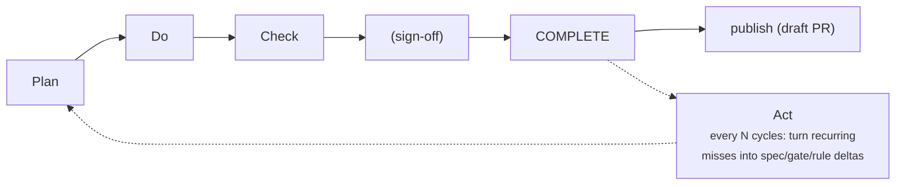

# Step 06 — Act: improve the process

← [05 Check](05-check.md) · [Index](README.md) · next: [07 Cross-cutting →](07-crosscutting.md)

**Beat: Act.** Touch point #3, and the last one. Plan/Do/Check operate on **one
contribution**. Act operates on the **process itself**, across *many* completed
cycles, on its own cadence (every N cycles, or weekly — *not* per-cycle). It's
what closes the PDCA loop: turning what several cycles exposed into a
permanently better baseline, so the *next* Plan starts from firmer ground.

Two parts follow: [**how to use**](#how-to-use) it — the commands, and three
real process deltas it produced — then [**how it works**](#how-it-works)
underneath: the leaf, what it reads (and explicitly refuses to do), where a
delta can land, and the cadence that keeps it from firing on noise.

## How to use

```bash
pdca act index                              # read-only: frozen cycles + recurring signals
pdca act log --date 2026-10-14 --append     # scaffold a dated entry into process/act-log.md
pdca triage <pr>                            # ingest a published PR's external review findings
```

Act reads the `COMPLETE` bundles' SUMMARYs — especially §6 (what needed a
human), §7 (what stayed unproven), and §10 (Act candidates the cycle flagged)
— looking for **patterns**. A one-off is noise; the same gap across three
cycles is a process defect.

### A real Act entry

This is from `wyrd-pdca/process/act-log.md` (2026-09-20), and it's the
clearest demonstration of why the beat exists. A post-merge review of Wyrd PR
#821 — bundle 800, a garbage-collection change rated `medium` — found three
P1 defects the cycle had not surfaced. The review asked *why the cycle missed
them*, not just what they were (trimmed; the full entry is about sixty lines):

```markdown
# Act review — 2026-09-20 — review coverage after wyrd PR #821 (no new frozen cycles; decided by Eduard Ralph in session)

## What the records exposed

- **The refutation pass never ran on #800.** `[[leaves.advisory]] adversary` was gated on
  `difficulty` containing "high"/"hard"; #800 and its parent #661 were rated `medium`, so the
  driver skipped it silently — no artifact, no note in §5. Every bundle that got an adversary
  pass (#771, #772, #803, #804, #635, #636, #681, #697) was rated `high`; #661, #693, #800
  (`medium`) and #655 (`low`) got none. ... `difficulty` is a size label the planner writes, not
  a statement about which invariants a slice touches.
- **Two findings were in nobody's pass.** The batched pre-PR review (3 codex passes) returned
  0 findings on a 119 KB patch the size backstop had flagged. Its rubric has no row for a
  transaction's sequential operation count (only bytes) ... Both are the
  correctness lens `agents/code-review.md` describes, which no leaf ran.
- **The ladder topped out on one lineage.** Escalation went sonnet/high → opus/max and stayed
  on opus; #637 hit an Opus-specific refusal twice in a row with no other family to fall to.

## Process deltas

- Gates / leaves: **three-tier builder ladder by attempt** — tier 1 sonnet/xhigh (every first
  attempt), tier 2 opus/xhigh (attempts 2 to 4), tier 3 fable/xhigh (attempt 5 on). ...
  The difficulty auto-route to opus is retired; `Do model:` pins remain ...
- Gates / leaves: **adversary always on** — the `when` gate on `difficulty` is removed.
  (`pdca.toml` `[[leaves.advisory]] id = "adversary"`)
- Gates / leaves: **third-party code-review lens always on** — new `[[leaves.advisory]]
  id = "code-review"`, codex family, `agents/code-review.md`, advisory.
- Spec template + agent prompt: **`Difficulty` no longer routes anything at Do or Check.**
  The planner prompt and the three brief templates now say so, name what the field still
  feeds (the size estimate), and tell the planner to pin `Do model:` ... for a brief it
  rates `high`, since the rating alone no longer buys a stronger first build.

## How effectiveness will be judged

- Every Check from here on shows three advisory artifacts (`check-review.md`,
  `check-advisory-adversary.md`, `check-advisory-code-review.md`); a missing one is a fault,
  not a gate.
- The next post-merge review on a merged PR finds nothing the cycle did not already have in
  §6. Two in a row that do trigger a rubric revision, not another leaf.
```

Trace the loop: three defects found *after* merge (§ outside the cycle) → Act
*generalizes* them ("the refutation pass was keyed on a field that measures
size, not risk") → concrete process deltas (two review leaves always on, a
ladder that climbs by attempt instead of by self-rating, a template that says
so) → which means **every later cycle's Check runs the lens that would have
caught them**. The 779 bundle in [step 05](05-check.md) shows the result:
`check-advisory-adversary.md` and `check-advisory-code-review.md` beside the
reviewer's report on a `medium` bundle, exactly as the entry's first
effectiveness test demands. That is the "→ back to Plan with a better baseline"
arrow made operational. Note the last line, too: the entry pre-commits to what
would prove the delta *wrong*, and names the different fix that would follow.

### The 779 findings, one review later

The two harness-shaped §6 items from [step 05](05-check.md) — the
diff-coverage row that gave the wrong reason, and the three-pass review that
finished in 26 seconds with nothing to say — are precisely the kind of signal
Act exists for: not a defect in the patch, a defect in the *instrument*. The
2026-10-14 review read 779 and nine other frozen cycles and found both were
patterns, not one-offs (trimmed):

```markdown
# Act review — 2026-10-14 — cycles considered: 656, 666, 671, 686, 722, 767, 778, 779, 894, 895 (decided by Eduard Ralph in session)

## What the records exposed

- **The gating T4 batch review leaves no evidence that it reviewed the diff.** 779 (26.8 s,
  31 KB patch) and 895 (13.03 s, 134 KB patch) each passed with `0 blocking, 0
  recorded-rejected, 0 noise-dropped`. Two independent reviewers flagged that a cached or empty
  pass would leave the same one-line log. There are two causes in `scripts/review-branch`.
  `:283` runs `codex exec` with no model and no effort, while every other Codex leaf is pinned to
  `gpt-6-astra` ... And `:486-488` prints a pass's note only when the pass fails, so a clean run's
  `review-batch.md` is 563 bytes of boilerplate.
- **The 2026-09-30 open item on C4-diff-cov's base came back positive, and the cause is in this
  repo's config.** For 779 (`Depends on: 778`, `stack-base` = `pdca-integration/main-r6da1b5689252`),
  `coverage/diff-cov.json` records `"base_ref": "origin/main"`. The build therefore lacked 778's
  `version` module (`E0433`), and the row misreported "executed 0 tests". The cause is
  `verifies_base = false` on the C4-diff-cov row (`pdca.toml:1527`) ... So the driver gives
  the row no base, and the ladder falls through to `origin/main` without the fallback warning.
  This is an instance config value, not an upstream bug.

## Process deltas

- **Gate, filed as getwyrd/wyrd-pdca#276** (https://github.com/getwyrd/wyrd-pdca/issues/276):
  `scripts/review-branch:283` pins the passes' model
  and effort, using the same pin as the other Codex leaves. `review-batch.md` and the gate log
  record, for every pass (clean ones included), its index, wall time, stdout bytes, note and
  model/effort, plus the sha256 of the reviewed `patch.diff`. ...
- **Agent skills, applied here: one standing id for that failure.**
  - Planner (`.claude/agents/planner.md:143-147`): reuse an already-registered doctor row's id,
    and name the base-advisory failure `cargo deny all-features advisories`.
  - Builder (`.claude/agents/builder.md:155-159`): when the unpatched base fails the advisory
    wall, declare exactly that token and propose no new row.

## Follow-ups routed

- **getwyrd/wyrd-pdca** (this repo's config, not upstream):
  - #277 (https://github.com/getwyrd/wyrd-pdca/issues/277): C4-diff-cov measures stacked
    bundles against `origin/main`, because
    `verifies_base = false` at `pdca.toml:1527` cuts it off from the base ladder. ...
- **Upstream (eduralph/pdca-harness):**
  - #741 (https://github.com/eduralph/pdca-harness/issues/741): a documentation fix. The
    template's `verifies_base` guidance ... says "exactly one
    such row". It should say that every row which resets to the bundle's base needs the flag.
    That framing led to `8ad0df6` and to #277 here.
```

Three things to notice. The adversary's §6 finding on 779 ("the coverage
checkout is on a base without #778") was *right*, and Act found the cause one
level deeper: a config key copied from guidance that was itself misleading — so
one follow-up fixes the instance and another fixes the template's words, each
filed where it belongs. The thin batch review turned out to be two code defects
in an instance script, filed as an issue with a test requirement rather than
patched in the review session. And the third delta, applied on the spot, is a
*vocabulary* fix: four planners had named the same base-wide dependency failure
four different ways, so the agent prompts now carry one standing id for it.

### Act also fixes gates

An earlier entry shows Act tightening a *gate*, not a leaf. On 2026-08-02 a
review of eighteen frozen cycles found that the instance's own per-fix verifier
had a hole in its red leg (trimmed):

```markdown
- **Gates — the RED leg's non-zero path is guarded (the 07-25 queued delta, now applied).**
  A pure `_red_verdict()` decides all four cells from cargo's status **and** what ran
  (`engine/scripts/run-verify.sh:181`), the RED leg routes through it (`:478-507`), and the
  `≠0 status / 0 tests` cell now reports **UNVERIFIABLE (exit 77 → §6 NEEDS-HUMAN)** with a
  message naming the usual cause, instead of PASS. ...
  *Known cost, accepted:* a slice whose RED leg genuinely cannot compile now raises a §6 item
  instead of passing silently — visible rather than free.
```

A compile error exits non-zero just like a failing assertion does, so a red leg
judged on the exit code alone had been recording "PASS — red without the fix"
for tests that never built. The delta judges every leg by two facts — the exit
code *and* the number of tests that ran — and the template's engine skeleton
now carries the same rule, routed upstream as issue #434 from this entry. That
is why 779's `C4-verify` row says "(1 test(s) ran red)".

### Closing the loop — the process-delta ledger

A delta is only worth anything if it *works*. Act keeps a
`process/act-ledger.json`: each recurring signal it surfaces is tracked
`open`; once you land the fix you run

```bash
pdca act resolve "<signal>" --location <path:line>
```

to mark it **applied**; and on a later review Act flags any applied delta
whose miss **recurs** in a cycle frozen after the applied date — a loud
"⚠ Ineffective deltas" section in `act index` / the `act log` scaffold. So Act
audits its own prescriptions instead of writing them and forgetting. The
"How effectiveness will be judged" section every Wyrd entry ends with is the
human half of the same habit.

### External review findings — `pdca triage` (issue #316)

The maintainer review on a *published* PR is the outer loop's highest-value
signal — and, until someone transcribes it, invisible to Act. `pdca triage`
does the transcription:

```bash
pdca triage https://github.com/OWNER/REPO/pull/123   # or OWNER/REPO#123, or a bare number with --repo
```

It pulls the PR's reviews and review comments via `gh api`, classifies each
finding (**BUG / CONVENTION / NOISE / TEST-GAP** — keyword heuristics, tunable
from the instance rubric's class list), and routes by class: a BUG on a merged
PR files a tracker issue whose body carries a carry-forward note; CONVENTION /
NOISE / TEST-GAP append candidate gate-row, rubric-line and rubric-exclusion
entries to `process/act-log.md`. Every finding also registers in the Act
ledger under a class-keyed signal (`codex-pr:<slug>`), so the ineffective-delta
audit above covers external findings too: a class that recurs *after* its
process delta was applied gets flagged. It **proposes only** — it never edits
`pdca.toml` or the rubric — and re-running the same PR ingests only findings
that arrived since the last run. Wyrd's INTEGRATION §8 makes it part of the
definition of done for a PR: when external findings arrive, process them with
`pdca triage` so every one lands in the ledger.

A spec-level delta can also become a mechanical one. The template ships a
reference check, `scripts/checks/test_exercises_production.py` (a
`[[gates.checks]]` example, issue #154), which asserts each *added* test file
imports the production package and declares itself UNVERIFIABLE → §6 when it
can't — promoting "test the production path, not a parallel copy" from a
human-only T5 judgment to a deterministically-surfaced one. Wyrd's briefs carry
the same rule in their `Production reach` field.

---

## How it works

### The leaf Act uses

Act has one leaf — `act`, interactive, like `planner` and `signoff`: the human
touch point is the whole beat, not a step inside it. The leaf instruments the
process — presenting the bundle index and recurring-signal candidates — but
`pdca act index`'s pattern-detection and the ledger are pure code; the leaf
only helps you draft the dated entry.

### What Act reads, and what it explicitly does not do

Act reads `COMPLETE` bundles only — frozen records, never anything in-flight.
What it explicitly does **not** do: re-decide any disposition, re-run the
suite, or write the next brief. It generalizes a pattern into a *candidate*
delta; a human still judges what to actually change (what rule to add, which
template field to revise, whether to retire a check) — the bundle index
surfaces patterns, the human decides. Wyrd's recent entries open with that
disclaimer ("No disposition is re-decided") and the 2026-10-19 review shows the
discipline holding under temptation: a one-line config fix for the
diff-coverage base was offered in session and declined — "fixes stay with their
issues, this review only files."

### Where deltas land

Act deltas land in five places: the **spec template** (a brief field), the
**ruleset** (a written rule), the **gates** (a new/promoted check), the
**agent role prompts** (`agents/*.md`), or the **orchestration**
(driver/state). Each is a permanent improvement to the baseline every future
cycle starts from — the next Do should not recreate the issue the previous Act
tried to eliminate; if it does, the Act wasn't effective (which is exactly what
the ledger's "⚠ Ineffective deltas" check is for). The three entries above hit
four of the five: leaves and gates (2026-09-20, 2026-08-02), the spec template
(2026-09-20), the agent prompts (2026-10-14).

### Cadence — why Act doesn't fire every cycle

`[driver].act_cadence` (default `5`) is why "every N cycles, not per-cycle" is
a real mechanism, not just a suggestion: `pdca flow` auto-runs Act only once
this many cycles have frozen **since the last Act review**, counted across
`flow` invocations (five separate one-bundle flows trip it on the fifth, same
as one five-bundle batch would). Below the threshold, a flow skips Act with a
hint instead of running it on too little evidence to show a pattern; `pdca act
log` still runs it on demand any time, and `--no-act` always forces a skip.
Set `act_cadence = 1` to restore "run after every completed flow." Wyrd runs
the default, and its log shows the other kind of entry too: an *out-of-band*
review, triggered by an event rather than the count — the post-merge findings
of 2026-09-20 were one.

### The loop, closed



You've now walked one contribution from a tracker issue to a merged,
signed-off, verified change — and seen how the cycle feeds its own improvement.
To do it for real, go back to [step 01](01-render-and-integrate.md) and render
the harness into your own project; the reference spec in
[`../template/PCDA/quality-cycle/`](../template/PCDA/quality-cycle/) is there
when you want the *why* behind any beat.

One more thing worth knowing before you go: three mechanisms — sizing/splitting
an oversized brief, how an iterate actually archives and carries context
forward, and running several cycles concurrently — cut across every beat above
rather than belonging to one of them. [Step 07](07-crosscutting.md) covers
them.

← [05 Check](05-check.md) · [Index](README.md) · next: [07 Cross-cutting →](07-crosscutting.md)
