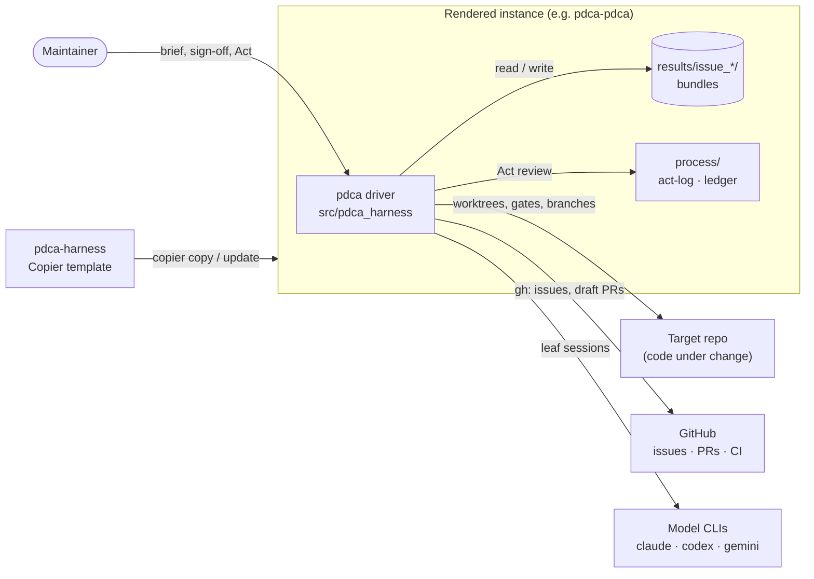

# 3. Context and scope

> Living document. The harness from outside. Open questions are marked **[OPEN]** inline.

## 3.1 System context

## 3.2 External interfaces

| Interface | Direction | Contract |
|---|---|---|
| `docs/INTEGRATION.md` + `pdca.toml` in the instance | in | The instance's concretization: tracker, branch targets, fixtures, gates, leaves (rendered from `template/docs/INTEGRATION.md.jinja`, `template/pdca.toml.jinja`). |
| Tracker (`gh issue view`, CSV export) | in | Source documents for Plan (`sources.py`). |
| Gate scripts (`[[gates.checks]]`) | out/in | rc 0 pass, rc 77 or a `PDCA-UNVERIFIABLE:` line unverifiable, anything else fail. **[OPEN]** written down only in code and spec doc 04 until the bundle-format spec (#712). |
| Model CLIs | out/in | Prompt on stdin; `stream-json` (claude) or JSON events (codex) back; profiles in `families.py`. |
| GitHub PRs | out | Draft PRs only; never ready, merge or approve (ADR-0004). |
| Instance git | out | `pdca record` commits finished bundles; Act writes `process/`. |

## 3.3 Out of context

Merging PRs, CI configuration of the target project, model hosting, and scheduling runs. Two
batch-housekeeping steps — choosing the next batch and consolidating an earlier run's PRs —
are done by a person today; #698 brings them into the Plan beat.
