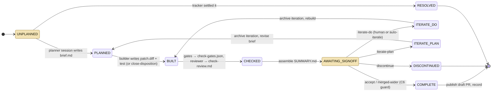

# 6. Runtime view

> Living document. How the components work together on the important paths. Open questions are
> marked **[OPEN]** inline.

## 6.1 The main path: one bundle

State is derived from files (ADR-0003); the shaded states are where the driver stops for a
person.

On accept, the publisher leaf drafts the commit message and PR description and the driver
opens a **draft** PR. Act runs when its cadence is due, over frozen bundles.

## 6.2 Other important paths

**A batch (`pdca flow <id> …`).** Unplanned ids share one planner session. The driver levels
the bundles into waves by their `Depends on` / `Conflicts with` edges (`waves.py`), runs each
wave across lanes in per-bundle worktrees, and stops at sign-off cheapest-first. In stack mode
each accepted wave is folded onto an integration line `pdca-integration/<base>-r<key>`
(`integrate.py`) and later waves are cut from it; a finished prerequisite from an earlier run
is carried onto the line before wave 0 (`flow._carry_finished`). In merge mode accepted PRs are
merged in wave order instead (`merge.py`), when the configuration allows it.

**A held bundle.** A bundle whose prerequisite is not on its line, not pushed, or in conflict
is held, named on one stderr line with the way out, and the run continues. **[OPEN]** the run
still exits 0 when it holds a bundle (#693).

**An interrupted run.** Running the same command again resumes every bundle from its files.
Per-bundle claims (`drive_claim.py`) stop two runs driving the same bundle.

**Auto-iterate.** When Check finds implementation-level problems only, the driver may record
`iterate-do` itself, up to `max_auto_iters`; findings that need a person are deferred to the
hand-over, never ticked.
