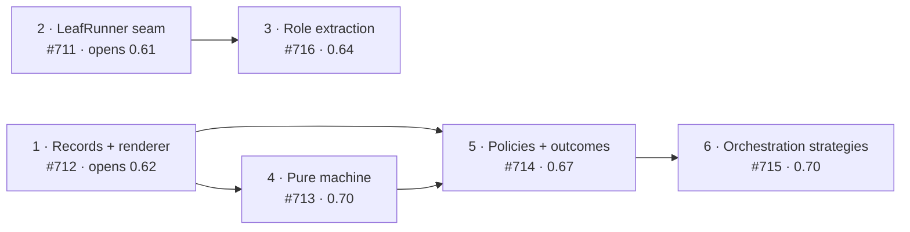

# 9. Build order and roadmap

> Living document. Summary of [proposal 0002](../proposals/accepted/0002-target-architecture.md)
> (target architecture and migration order), which holds the detail. GitHub milestones carry
> the same numbers. Open questions are marked **[OPEN]** inline.

## The order

A strangler migration (ADR-0016): each step keeps the suite green, opens with its ADR, and is
done only when its exit gate is met.

| Step | Issue | ADR | Exit gate |
|---|---|---|---|
| 1 Records + renderer (bundle-format spec first) | #712 | 0009 | No `_section_span`, `_OUTCOME_RE`, `_needs_human_rows` or `_FIELD_RE` call in the accept path. |
| 2 LeafRunner seam (budgets, token ledger) | #711 | 0010 | `leaves.py` has no direct `subprocess` use; every attempt has a token row. |
| 3 Role extraction | #716 | 0011 | `leaves.py` under 800 lines; reviewer verdicts arrive as schema-validated JSON. |
| 4 Pure machine | #713 | 0012 | `flow.flow` deleted; `_drive_and_act` under 120 lines. |
| 5 Policies + outcomes | #714 | 0013, 0014 | wyrd's local patches expressible as `pdca_ext/` policies; `pdca flow` exits non-zero on a held or failed bundle. |
| 6 Orchestration strategies | #715 | 0015 | Every open stack-mode issue closed by an invariant or reproduced by a generated case. |

Milestones: finish 0.60 (stack-mode fixes) → 0.61 opens with step 2 → 0.62 opens with step 1
→ 0.63 → step 3 in 0.64, before the interactive-leaf work of 0.65 → step 5 in 0.67 → steps 4
and 6 in 0.70.

## Where to start contributing

- The 0.61 bugs, starting with #710 (sign-off can write §9).
- #711 (step 2) and #717 (compute or drop `Confidence`) are self-contained.
- Read ADR-0003 to ADR-0006 before touching the accept path.

## Later

- A "lite" profile (brief, gates, red/green, one cross-vendor review, draft PR) for small
  projects — proposal 0001, improvement 9; not needed yet.
- Eval-gated prompt changes — improvement 7; waits for the token ledger.
- Batch selection and consolidation as Plan-beat leaves — #698 (#699–#701), built behind the
  step-2 runner.
