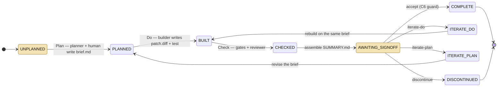

<!-- Proposal 0001, added verbatim from the maintainer's document of 2026-10-15. The only
     edits: the diagrams lost in export ("[embedded content: …]") are redrawn below as Mermaid
     from the surrounding text, and cross-references point at the other proposal's file. -->

# pdca-harness — approach review (Oct 2026)

Oct 15, 2026 · @Eduard Ralph

## Verdict

The approach is right; the implementation has outgrown it. The core bet — a deterministic, file-derived state machine that drives Plan→Do→Check→Act, keeps every LLM out of the accept decision, demands red-before/green-after evidence, and decorrelates the reviewer from the builder — is still ahead of what Anthropic, OpenAI, GitHub or any third-party tool ships as of October 2026. Anthropic's own engineering posts keep rediscovering the problems it solves (lenient self-grading, agents marking work done without end-to-end tests, green CI not meaning the task succeeded).

Two things are wrong, and neither is the model. First, the Check beat generates human work that is ritual: §2 Confidence is `medium` in 251 of 251 bundles, and two §6 classes (fitness-to-purpose, T5 prior-art) fire in every cycle and can never be cleared by a leaf — roughly 30% of all NEEDS-HUMAN items. Second, the harness is now a platform in its own right (28k lines of driver, 49k lines of tests, 690 PRs, 107 open issues) without the two numbers a platform needs to rank its own work: cost per attempt and ritual rate per bundle. The empirical base is one Rust project plus self-hosting; autobook and nl-shell are new and not yet a verdict either way.

The recommendation is to instrument cost and time per attempt (nothing is recorded today), rebuild the Check beat around a per-row *evidence contract* rather than a prose verdict, give the platform a stable core and a release cadence instances can pin against, and move the parts the vendors now do well (worktrees, budgets, structured output, stop-hook gates) onto their primitives. Details in sections 6 and 7.

## What the harness is, as built

One contribution is one bundle in `results/issue_<id>/`, and the bundle's state is *computed from which files exist* — no database, fully resumable. `pdca flow` (`flow_ids` → `_drive_and_act` → `_drive_wave`) advances every bundle through beats and stops only at five halted states (UNPLANNED, AWAITING\_SIGNOFF, COMPLETE, DISCONTINUED, RESOLVED).

> *Diagram redrawn as Mermaid from the text; the original was lost in export.*

The shaded states are where the driver halts for a person; everything between them runs unattended, and no model writes the §9 outcome.

The builder, reviewer, adversary and sizer are headless `claude -p --agent <role>` or `codex` subprocesses with the prompt on stdin and `stream-json` parsed for a heartbeat. Planner, sign-off, publisher and Act are interactive sessions that inherit the TTY. One place (`leaves._invoke`) builds the argv; vendor differences are data in `families.py`.

What each leaf sees is deliberately asymmetric. The builder gets a pointer to the brief plus `$PDCA_WORKTREE` and reads the archive of earlier iterations itself; the brief grows by one carry-forward block per iteration. The reviewer runs in a temp dir holding only `patch.diff`, `brief.md`, `check-gates.json` and the gate logs, with a disposable git copy of base+patch so it can `git stash` and re-run red→green itself — `build-notes.md` is physically absent. Advisory leaves are picked by *vendor complement* against the builder that actually ran.

Gates are `[[gates.checks]]` rows run with `shell=True` in a fail-closed reconstructed worktree; rc 0 passes, rc 77 or a `PDCA-UNVERIFIABLE:` line is unverifiable, anything else fails. Only a gating `fail` blocks; unverifiable rows become §6 items. The 11-row 5/5/1 matrix (C1–C5, T1–T5, V) is overlaid on whatever gates exist. There is no baseline diffing in the Check path.

Acceptance is mechanical on the headless path: `signoff.record` is the only writer of §9, `_apply_decision` is its only caller, and any open `- [ ]` under the last `## 6. NEEDS-HUMAN` heading refuses `accept`. Auto-iterate can write only `iterate-do`, only while an IMPL-tagged item exists, never past `max_auto_iters`, and defers HUMAN items into `deferred-findings.json` rather than ticking them.

Around that core sit sizing (an a-priori estimate calibrated on 86 bundles, escalated by a haiku sizer), splitting (a splitter leaf proposes children; `split.accept` materialises them transactionally), waves (dependency and conflict edges levelled by longest path), lanes (N workers, `$PDCA_LANE`), per-cycle worktrees, memory caps via `systemd-run`, a draft-PR publisher, stack/merge integration lines, and `pdca act index|log` that mines frozen §6/§7/§10 for recurring signals. The whole thing is a Copier template; instances pull updates with `copier update`.

## What the instances show in practice

Only wyrd-pdca and pdca-pdca have run cycles; autobook-pdca and nl-shell-pdca have no `results/` and an untouched act-log. All four pin template v0.59.0 and answer `leaves_mode: stub` in copier while every `pdca.toml` runs `mode = "command"` — the copier answer is stale everywhere.

|  | wyrd-pdca | pdca-pdca | autobook-pdca | nl-shell-pdca |
| --- | --- | --- | --- | --- |
| Bundles | 155 | 111 | 0 | 0 |
| Published (draft PR) | 119 | 95 | – | – |
| Discontinued | 6 | 2 | – | – |
| Archived iterations (mean/bundle) | 372 (2.4) | 124 (1.1) | – | – |
| Max rounds on one bundle | 16 (`issue_635`) | 6 (`issue_593`) | – | – |
| Live patch size, median / max | 53 KB / 1,048 KB | 26 KB / 183 KB | – | – |
| §6 NEEDS-HUMAN items (ticked) | 708 (654) | 555 (547) | – | – |
| Instance glue, lines | \~4,000 + \~2,300 local patches to `src/` | \~1,600 | \~1,000 | \~750 |
| Act reviews | 31 | 16 | 0 | 0 |

**What the human actually clears.** Of 1,263 §6 items, roughly 30% are structurally un-clearable by any leaf: the V-row fitness-to-purpose cell (227) and the T5 prior-art cell (158, because the reviewer's disposable target has one synthetic commit and no remote — harness #575). Another 102 are gating reviews the clearing reviewer could not reproduce (it cannot see `scripts/review-branch`), and 167 are C4 rows marked UNVERIFIABLE — net-new code, docs-only or test-only changes with no isolable red. The content that needs a person — scope calls, causal adequacy, mutant survivors, size — is a minority of what the person is asked to tick.

**Where rounds go.** The oversized-slices report in wyrd measures the knee: patches under 50 KB take a median of 2 rounds, patches over 250 KB a median of 8.5 and never fewer than 6. The same report records that no round ever produced a smaller patch than the previous one and that the batched codex review sampled a 31-row diff with zero cross-pass agreement. Other round-eaters are environmental — a base branch that did not exist in the sandbox (5 lost rounds on 635), a stale `cargo-deny` turning CI red, `cargo: not found` four times, 7,200 s gate timeouts — and auto-iterate rebuilding a 3 KB comment fix four times on opus/max because a reviewer C4 row was tagged IMPL (harness #691).

**What Act learned.** The 47 Act reviews produced real deltas: a `Verification posture` brief field, 15 reviewer finding classes mined from 158 external codex comments on 79 PRs, a red-leg compile-failure fix in `run-verify.sh` (a compile error had scored PASS), a 16 GiB reviewer memory cap after an OOM took a whole session, a Plan intake cap of 6 after August opened 78 issues and closed 20, sonnet→opus as builder baseline after 4 of 4 sonnet-first bundles escalated, merge→stack wave mode. The ledger also records what Act cannot fix from inside an instance: "no instance delta warranted — the gap is harness machinery" is the modal conclusion of the last five pdca-pdca reviews. Issue inflow in wyrd was 204/187/78/0 opened against 132/108/20/1 closed, June through September; 63 of the 64 open August issues were the cycle's own output (split children, findings filed as issues, Act follow-ups).

**Silent failures that the design was meant to exclude.** Nine consecutive pdca-pdca bundles recorded "plan review: 0 findings" because the plan-reviewer leaf's fail-closed sandbox never started on an AppArmor-restricted host and rc 0 with no output was classified as substantive. The codex reviewer sits at exactly its 16 GiB cap in 17 of 17 sampled runs (page cache is counted). wyrd's gating pre-PR review was red in 72% of Check runs (197 of 272).

**What is not recorded.** No token or dollar figure exists anywhere in either instance. `loop-telemetry.json` holds model and effort per attempt; `check-gates.json` holds gate durations (C4-ci median 131 s, C5-mutants median 90 s, max 7,201 s); memory logs give leaf wall-clock (builder median 885 s, codex reviewer 570 s). Bundle wall-clock from first to last gate is a median 6.1 h in wyrd, with outliers at 52 h and 73 h. The cost of 372 archived iterations cannot be computed from the records.

## Comparison with Anthropic, OpenAI and the field

The building blocks have become commodity; the cycle has not. Every vendor now ships deterministic stop-gates, headless JSON with cost, worktree isolation and scheduled cloud runs. Nobody ships a cross-cycle state machine, an evidence-gated acceptance that excludes the LLM, a cross-vendor reviewer, or an Act log.

| Capability | pdca-harness | Claude Code (Oct 2026) | OpenAI Codex (Oct 2026) | Nearest third party |
| --- | --- | --- | --- | --- |
| Deterministic gate on completion | `[[gates.checks]]`, rc/marker protocol | `Stop` hook, `command` type; `/goal` is model-judged | `Stop` hook with `decision: block` | GitHub gh-aw safe-outputs |
| Evidence requirement | red-before/green-after, gating | guidance only ("show evidence, not assertion") | none | Spec Kit bug ext. (`verified / partial / failed`) |
| LLM excluded from accept | yes, `signoff.record` + C6 guard | no; `/goal` and `agent` hooks are model verdicts | no; `--approve-for-me` | gh-aw read-only agent + scoped write job |
| Decorrelated reviewer | cross-vendor by default, no builder notes | same vendor; subagent `model` is Anthropic-only | `@codex review` is static, same vendor | Jules critic, Cursor Bugbot (same vendor) |
| Spec / brief | parsed brief with field contract | plan mode, CLAUDE.md | AGENTS.md, 32 KiB cap | Kiro requirements/design/tasks, Spec Kit |
| Parallelism | lanes + waves + per-cycle worktree | `--worktree`, `/batch` 5–30 subagents, agent teams (experimental) | subagents, no worktree isolation | Cursor Projects coordinator, Amp orbs |
| Size control | a-priori sizer + empirical backstop + splitter | none | none | Kiro waves; AIDev data: 17% larger PRs fail |
| Cost control | none recorded | `--max-budget-usd`, `--max-turns`, `total_cost_usd` | `--output-schema`, no budget flag | gh-aw `max-ai-credits` |
| Process learning | `pdca act index/log`, ledger | `claude plugin eval` (prompt A/B with baseline) | none | agent-levers Act → AGENTS.md rules |
| Unattended run | `pdca flow` + lanes | cloud sessions, routines (green ≠ success) | Codex cloud tasks | Devin, Copilot coding agent |

Three points matter for the decision.

Anthropic's own practice confirms the premise. The March 2026 harness-design post found that models grade their own work leniently and that a solo agent produced broken output for $9 where a planner/generator/evaluator harness produced working output for $200. The November 2025 long-running-agents post found Claude marking features done without end-to-end tests. The routines documentation says a green status means only "no infra error" and to read the transcript. Auto mode reports a 17% false-negative rate. Each of these is the problem the C6 guard, the red/green gate and the human sign-off exist to solve.

The vendors' new primitives overlap with harness code you now maintain. `claude -p --worktree`, `--max-budget-usd`, `--max-turns`, `--json-schema` structured output, `--bare` for CI, `SubagentStop`/`TaskCompleted` hooks, `/batch`, and `claude plugin eval` each replace something `leaves.py`, `worktree.py` or `progress.py` does by hand — and the vendor's version is tested against every release. Codex offers `codex exec --json --output-schema` and a `Stop` hook, so it remains a sound reviewer leaf.

The closest independent analogue, agent-levers (Aug 2026), reaches the same shape — brief on disk, typed verifiers, budgets, a Check that re-runs verifiers in a fresh shell, an Act that writes rules into AGENTS.md reviewed in the same PR — with one order of magnitude less machinery and no decorrelated reviewer. The AIDev corpus (932,791 agent PRs) gives the empirical argument for sizing: 28.5% of agent PRs fail to merge, each failed CI check cuts merge odds about 15%, and rejected PRs are about 17% larger. Nobody has published evidence for red-before/green-after as a standard; it is practitioner guidance only, which makes your 266 bundles one of the larger datasets on it.

## Strengths

The strengths are in the invariants, and they are better than the vendors' equivalents.

- **File-derived state, no database.** Any crash is resumable by re-running `pdca flow`; every bundle file is treated as possibly absent; HALTED and TERMINAL sets are explicit. This is the right primitive for a long-running, interruptible, multi-day process and nobody else has it.
- **Accept is code, not prose.** `signoff.record` is the single writer of §9; `accept` is refused while any `- [ ]` is open under the last §6 heading; the last-heading rule and the opposite fail-safe directions for open vs. ticked rows are careful engineering. Auto-iterate can only ever write `iterate-do`.
- **Settled-marker discipline.** A failed leaf is distinguishable from an interrupted one (`ATTEMPTS_SPENT_MARKER`, `neutralize_leaf_text` so a leaf cannot forge it), and `_LeafHarvest` prevents a dead attempt's residue being filed as the live verdict. Most harnesses conflate "no output" with "nothing found"; this one mostly does not (the plan-reviewer incident is the exception and is filed).
- **Executable red→green in the reviewer's hands.** The reviewer gets a disposable git copy of base+patch and re-runs the red leg itself by stashing production hunks. That turns "the reviewer agrees" into "the reviewer reproduced".
- **Decorrelation by construction.** Different vendor by default, `build-notes.md` physically absent, advisory leaves chosen by vendor complement against the builder that actually ran, a same-vendor fallback that leaves a §6 note. The adversary prompt ("default to refuted when uncertain; a missing toolchain is not a refutation") produced most of the useful rebuild orders in the long pdca-pdca bundles.
- **Self-reports never drive control flow alone.** `dependency_halt` honours a builder's "external dependency" claim only when a `[[doctor.checks]]` probe exits non-zero. Fail-closed worktree reconstruction before every gate read. Transactional split acceptance with lineage.
- **Vendor differences are data.** `families.py` profiles make a codex reviewer or a gemini advisory a config change, which is how wyrd ran a GPT-6 reviewer against an Opus builder without touching the driver.
- **The Act loop works when it is fed.** Real process deltas came out of it (Verification posture, review rubric classes, the red-leg compile bug, the intake cap, the builder baseline change), and the act-ledger is a genuinely new artefact in this space.
- **Test culture.** 2,459 offline tests pass clean in 232 s; stub mode lets the entire state machine run without a token; stream fixtures replay real CLI output.
- **The problem statement is correct** and now independently confirmed by Anthropic's own harness and eval posts: the maintainer must not be the only safety net, the agent must not grade itself, and green CI is not success.

## Weaknesses and risks

The weaknesses cluster into four: the harness is too big for its load-bearing core, the Check beat manufactures ritual, the guarantees have holes on the interactive path, and the process has no cost signal.

**1. Scope and weight.** `leaves.py` is 4,706 lines and holds invocation, retry, harvesting, memory caps, sandbox seeding, six leaves' prompts and stubs, the sizer, the splitter, two advisories, Act and publish. `flow.py` is 2,834 lines with a 360-line `_drive_and_act`. Twenty lazy `from . import …  # avoid an import cycle` sites show the module graph is cyclic. Two drivers exist for one state machine (`flow.flow` and `flow_ids`), held together by a parity test. Docstrings carry issue archaeology at more than 1:1 prose-to-code and encode invariants no test checks. wyrd-pdca carries \~2,300 lines of local patches to `src/` that `copier update` will revert — the Act log warns about this repeatedly. Each of the four instances needed 750–4,000 lines of glue; the template's 94-line `run-verify.sh` became 208–551 lines everywhere. The backlog is 107 open issues across nine milestones. The August push was a deliberate investment in the harness to support the downstream projects, and it shows in the record as more commits landing in wyrd-pdca than in wyrd that month; the point here is not that the investment was wrong but that nothing yet measures what it bought.

**2. Check produces ritual.** `assemble.py:622` hardcodes `- Confidence: medium` — the field has never carried information in 251 bundles. The V-row fitness-to-purpose item and the T5 prior-art item fire in every cycle and no leaf can clear them; with the "reviewer could not run X" class they are \~30% of all human ticks. Deferred HUMAN items are re-merged into every later §6 without re-checking (#642). A human who ticks 700 boxes, most of them the same box, stops reading the boxes — which defeats the one thing the design exists to protect.

**3. Holes in the guarantee.** The interactive sign-off agent has `tools: Read, Edit, Write, Bash, Grep, Glob` and there is no deny rule on `SUMMARY.md` in `settings.json`, `guard.py` or any hook; `state.state` trusts §9 text, so a model that writes `- Outcome: accepted` bypasses C6 and releases publish. The guard there is prompt plus a watching human. The claude builder runs with cwd = harness root and `--add-dir <worktree>` (`leaves.py:2498`) with project-wide `Edit`/`Write`/`Bash` allowed; confinement to the worktree is prose, and it can edit `pdca.toml`, hooks or other bundles. Codex gets real cwd confinement; claude does not. Nothing in `doctor` verifies `reviewer.family != builder.family`; the "MUST differ" lives in copier help text. `_same_finding` decides whether a human tick retires a deferred finding by a 60%-prefix fuzzy match on normalised prose (`autoiterate.py:167`) — in the accept path. The gate marker protocol reads `PDCA-UNVERIFIABLE:` off merged stdout+stderr, so a child that prints the token at line start flips a green to unverifiable.

**4. No wall-clock or cost bound on leaves.** `leaves._invoke` never passes `timeout` to `run_with_heartbeat`; only gates have `timeout_secs`. No `--max-turns`, no `--max-budget-usd`. A hung `claude -p` stalls a wave; a 3 KB comment fix got four opus/max rebuilds; no record exists of what any of it cost. The Act review on 2026-09-28 says it plainly: attempt count is the only cost the harness records. Without a cost signal, Act cannot judge whether a delta paid for itself, and the escalation ladder makes spinning the most expensive steady state (the oversized-slices report's own conclusion).

**5. State lives in LLM-authored Markdown.** The accept decision depends on `_section_span` over ` ##  ` headings, `_OUTCOME_RE`, `_needs_human_rows` splitting `|` cells, `_FIELD_RE` over brief fields. The code is defensive (fail-closed on two V rows, last-heading rule), but every reader is a parser over model prose, and #527/#606/#634 are the same bug class recurring. #607 names it as a design issue and is unassigned.

**6. "Contain and degrade" hides bugs.** `flow._isolate` swallows every `Exception` to stderr (`flow.py:52`); carry-forward, ledger retirement, sandbox seeding and worktree creation `except Exception: pass`. A deterministic assembly bug leaves a bundle silently at CHECKED, and the CLI exit code reflects state, not errors (#693). The nine-bundle plan-reviewer outage is this class: rc 0 and no output was "0 findings".

**7. Size is the dominant cost driver and the controls are soft.** The sizer is advisory (`size_guard="hold"` is treated as warn at 62% precision); the empirical backstop fires at Check, after the build was paid for; no round ever shrank a patch; the splitter produced a child larger than its parent (635: 19,228 added lines). Issue inflow exceeded outflow for four months because split, filed findings and Act follow-ups are three producers against one consumer.

**8. Narrow calibration base.** The sizing weights are calibrated on 86 bundles from one Rust project, and every §6 and round statistic above comes from wyrd plus self-hosting. autobook and nl-shell will add Python data once they run; until then the thresholds (`patch_kb=125`, `files=25`, the 50 KB round knee) are wyrd's numbers, not the harness's.

**9. Smaller but real.** `_next_iteration_no` counts stray files that `state.iteration_archives` filters (numbering desync). `progress._terminate_group` calls `os.killpg` unconditionally, so a timed-out gate on Windows raises and leaks the child. The brief grows unboundedly with carry-forward blocks and feeds `brief_bytes` into sizing. The codex reviewer pins the 16 GiB cap on every wyrd run and nobody has asked why. Three near-identical `_run_*_sandboxed` choreographies.

## Is it the right approach?

Yes for the model, no for the current shape of the implementation, and the two must be separated to answer honestly.

**The model is right and the alternatives are worse.** The three alternatives on the table are (a) vendor-native loops — `/goal`, Stop hooks, Codex goal mode, routines — which keep the LLM as the judge of done and have no cross-cycle memory; (b) PR-review products — Codex review, Copilot agent, Bugbot — which review a diff with no spec, no red/green proof and the same vendor; (c) spec-driven kits — Spec Kit, Kiro — which structure the Plan beat and stop. None gives you an acceptance that a model cannot forge, a reviewer that did not write the code, or a place where process deltas accumulate. For the workload you describe — funnelling AI contributions into real codebases at volume, with a maintainer's attention as the scarce resource — PDCA with a deterministic driver is the correct frame, and the data from wyrd (119 draft PRs with evidence bundles from one maintainer) supports it.

**The implementation is now a platform, which is a legitimate choice — but it changes what Act must measure.** Three signals say the platform is steering by feel: the harness backlog (107 open, nine milestones, 690 PRs) is larger than any instance's; the Act loop's modal conclusion is "the gap is harness machinery"; and wyrd holds 2,300 lines of local patches rather than wait for upstream. A platform needs what a harness could do without: a stable core API that instances pin against, a release cadence they can plan around, and a cost signal so platform work is ranked by what it saves across instances rather than by which issue was filed last.

**Where it fits.** Repeated contribution to a codebase with real conformance rules and a maintainer who will sign off; multi-branch, multi-issue batches; projects where the cost of a wrong merge exceeds the cost of a day of review. Wyrd is that. The harness developing itself is that only in part — it is also where the ritual, the inflow and the self-referential backlog come from.

**Not yet exercised.** autobook and nl-shell are new; zero bundles is a starting condition, not a verdict, and letting them take time for the framework to pay off is reasonable. The one thing to watch when they start: whether the 11-row verdict and the §6 list on a 20 KB Python patch read as leverage or as ceremony — that is the earliest signal the ritual rate (improvement 4) is meant to catch, and the first Python data for the sizing weights.

**What to stop doing.**

- Record per-attempt cost and time and the §6 ritual rate (items no leaf can clear ÷ all items) before the next platform milestone, so 0.61+ work is ranked by what it saves. Without those two numbers no further Act delta can be evaluated.
- Stop treating every reviewer finding as a §6 row. A finding is a §6 row only if it names an evidence check the human can run; everything else is advisory text in §7.
- Stop splitting into children that are not themselves size-bounded (635). A split whose child exceeds the parent's budget is refused, not published.
- Stop carrying local harness patches in instances. Either the change is upstream within one release or the instance pins the template commit and stops running `copier update`.
- Stop presenting `Confidence: medium`. Delete the field or compute it from gate coverage.

## Improvements not already in the backlog

I checked the 107 open issues (milestones 0.60–0.70) so that none of these duplicates filed work; where one is adjacent it is named. Order is priority: the first three unblock judging everything after them.

| # | Improvement | Why now | Effort | Adjacent issue |
| --- | --- | --- | --- | --- |
| 1 | **Cost and time ledger per attempt.** Parse `total_cost_usd`, `duration_ms`, `num_turns` from the claude result event and codex `turn.completed` usage into `loop-telemetry.json`; `pdca act index` reports cost per bundle, per round and per Act delta. | Attempt count is the only cost recorded; 372 archived iterations are unpriceable; Act cannot say whether any delta paid for itself. | S | #514 (transcripts, not cost) |
| 2 | **Leaf budgets.** `[leaves.*]` gains `timeout_secs`, `max_turns`, `max_budget_usd`, passed through as `--max-turns`/`--max-budget-usd`; exhaustion is its own §6 class and never retried by auto-iterate. | `_invoke` passes no timeout; a hung `claude -p` stalls a wave; a 3 KB fix cost four opus/max builds. | S | #610 (usage window), #691 |
| 3 | **Close the sign-off hole.** PreToolUse hook denying `Edit`/`Write` on `SUMMARY.md` and `signoff-decision` for the signoff agent; a `doctor` row asserting `reviewer.family != builder.family`; the claude builder run from the worktree (via `--worktree` or inline agent definition) instead of harness root with prose confinement. | §9 can be written by the interactive model today and `state.state` would read it as COMPLETE; decorrelation is unenforced; builder can edit `pdca.toml`. | S–M | #551 (OS sandbox, broader), #471 |
| 4 | **§6 evidence contract.** Every NEEDS-HUMAN row gets a stable id (`<!-- pdca:finding <sha> -->`), a kind (`gate` / `judgment` / `standing` / `infra`) and an evidence pointer. `standing` cells (V fitness, T5 prior-art) render once as a sign-off header, not as rows; `infra` (leaf did not run) is a run failure that blocks accept rather than an empty verdict; ticks retire by id, not 60%-prefix fuzzy match. Report a **ritual rate** (standing+infra ÷ all) per bundle. | \~30% of 1,263 human ticks are ritual; the plan-reviewer ran zero times in nine bundles and recorded "0 findings"; #527/#606/#634/#642 are one bug class. | M | #607, #642, #575 |
| 5 | **Convergence gate + pre-Do size budget.** Check compares the patch to the previous round: if it grew and the blocking-finding count did not fall for two rounds, the only permitted disposition is `iterate-plan` and auto-iterate must not fire. The sizer becomes a hard hold before Do unless the brief carries an explicit `Size override:`; `split.accept` refuses a child estimated above the parent's budget. | No round ever shrank a patch; 635 ran 16 rounds and its split child outgrew the monolith; the backstop fires after the build is paid for. | M | #556 (tolerance band), #645 |
| 6 | **Structured reviewer output.** Run the reviewer with `--bare --json-schema` (claude) or `--output-schema` (codex) so the 11-row verdict table arrives as JSON, with `check-review.md` rendered from it. | Every accept-path reader is a Markdown parser over model prose; #607 is the design issue and this is the first concrete cut. | M | #607, #601 |
| 7 | **Eval-gated prompt changes.** Keep 20–30 frozen bundles as a fixture set; a change to any `agents/*.md` runs `claude plugin eval`-style A/B (with and without) and ships only with the delta report in the PR. | Prompt deltas are the commonest Act output and nothing measures them; Anthropic now ships the tooling. | M | — |
| 8 | **Act judged by flow.** Each Act review records opened vs closed, rounds/bundle, cost/bundle, time-to-sign-off and ritual rate for the window; a delta is kept only if the next N bundles move the metric it targeted. | June–September inflow 469 opened vs 261 closed; the intake cap came from an out-of-band analysis, not from `act index`. | S | #544, #594 (caps, not the metric) |
| 9 | **Lite profile.** A copier answer `profile = lite` renders brief + gates + red/green + one cross-vendor review + draft PR, with no sizer, splitter, waves, lanes or act index. | Not needed yet — autobook and nl-shell are new and should get the full cycle first. Worth having for the next small project so the full harness is an opt-in rather than the only entry. | M | — |
| 10 | **Platform discipline: core/extensions split with a stability promise and a release cadence.** `core` = state, gates, signoff, assemble, driver, publish; everything else opt-in. Instances pin a core version; `copier update` never changes core semantics within a minor; a fixed cadence so an instance can wait for upstream instead of patching `src/`. | The harness is a platform now; wyrd carries 2,300 local lines because there is no cadence it can plan around; 20 lazy imports; 107 open issues across nine milestones. | L | #505 (overlaps; this is a scope cut, not a restructure) |
| 11 | **Count RSS, not page cache, in the memory scope.** Read `memory.stat anon` rather than `memory.current` for telemetry and the OOM post-mortem. | The codex reviewer sits at exactly 16 GiB in 17 of 17 samples. | S | #510 |
| 12 | **Infra failures are run failures.** A leaf that exits 0 without its artifact, or a gate that cannot start, fails the run (non-zero exit, bundle held) instead of degrading to an empty verdict. | `_isolate` swallows every exception; #693 exits 0 on held bundles; the nine-bundle outage. | S | #693, #509 |

Two things I would not do. I would not move the Check beat onto `/goal` or `agent`-type hooks: both put a model's verdict back in the accept path, which is the one thing the design gets right. And I would not pursue agent teams or `/batch` for lanes yet: they are experimental and interactive-only, and your lanes already work.

The architecture that items 4, 6, 10 and 12 add up to, with a migration order: [Target architecture](0002-target-architecture.md)

## Sources and evidence

**Repositories read (shallow clones at HEAD, 2026-10-15).** eduralph/pdca-harness (template, 28,046 lines in `template/src/pdca_harness`, 2,459 offline tests passing), eduralph/pdca-pdca, getwyrd/wyrd-pdca, Ralphovi/autobook-pdca, eduralph/nl-shell-pdca (the repo the message calls nl-speech-pdca), eduralph/pdca-project-template, eduralph/pdca.dev. Instance numbers come from `results/*/SUMMARY.md`, `check-gates.json`, `loop-telemetry.json`, `*.memory.jsonl`, `process/act-log.md`, `process/act-ledger.json`, and wyrd's `docs/2026-07-31-oversized-slices-report.md` and `docs/2026-09-11-backlog-reversal-proposal.md`. Open-issue list from the GitHub REST API (107 open).

**Code locations cited.** `leaves.py:583` (`_invoke`), `:680` (no leaf timeout), `:2498` (claude builder cwd), `:2723` (reviewer prompt), `:2819` (reviewer repo), `:3645` (vendor complement); `assemble.py:299` (finding classification), `:389` (`collect_needs_human`), `:622` (`Confidence: medium`); `signoff.py:255` (`record`); `flow.py:52` (`_isolate`), `:134` (`_apply_decision`), `:2216` (`_drive_and_act`); `autoiterate.py:167` (`_same_finding`), `:200` (`eligible`), `:457`; `gates.py:342`, `:847` (`_classify`), `:926`; `state.py:187`, `:339`; `driver.py:361`, `:369`; `progress.py:349`; `.claude/agents/signoff.md.jinja`; `.claude/settings.json`; `pdca.toml.jinja:503`, `:622`.

**Vendor and field sources (opened, Oct 2026).**

- Claude Code: [hooks](https://code.claude.com/docs/en/hooks), [/goal](https://code.claude.com/docs/en/goal), [best practices](https://code.claude.com/docs/en/best-practices), [headless / Agent SDK via CLI](https://code.claude.com/docs/en/headless), [subagents](https://code.claude.com/docs/en/sub-agents), [worktrees](https://code.claude.com/docs/en/worktrees), [agent teams](https://code.claude.com/docs/en/agent-teams), [routines](https://code.claude.com/docs/en/web-scheduled-tasks), [plugin evals](https://code.claude.com/docs/en/plugin-evals), [Ralph Wiggum plugin](https://raw.githubusercontent.com/anthropics/claude-code/main/plugins/ralph-wiggum/README.md)
- Anthropic engineering: [effective harnesses for long-running agents](https://anthropic.com/engineering/effective-harnesses-for-long-running-agents) (Nov 2025), [demystifying evals](https://www.anthropic.com/engineering/demystifying-evals-for-ai-agents) (Jan 2026), [building a C compiler with parallel Claudes](https://www.anthropic.com/engineering/building-c-compiler) (Feb 2026), [auto mode](https://www.anthropic.com/engineering/claude-code-auto-mode) (Mar 2026), [harness design write-up](https://understandingdata.com/posts/generator-evaluator-harness-design/) (secondary; original fetch failed), [managed agents](https://anthropic.com/engineering/managed-agents) (Apr 2026), [redesigning source control](https://www.anthropic.com/engineering/redesigning-source-control) (Oct 2026)
- OpenAI Codex: [non-interactive mode](https://learn.chatgpt.com/docs/non-interactive-mode.md), [hooks](https://learn.chatgpt.com/docs/hooks.md), [subagents](https://learn.chatgpt.com/docs/agent-configuration/subagents.md), [AGENTS.md](https://learn.chatgpt.com/docs/agent-configuration/agents-md.md), [code review](https://learn.chatgpt.com/docs/code-review.md), [Agents SDK](https://openai.github.io/openai-agents-python/); DevDay 2026 and goal-mode dates are from third-party recaps and unverified
- Field: [GitHub Agentic Workflows](https://github.github.com/gh-aw/), [Agent HQ](https://github.blog/news-insights/company-news/welcome-home-agents/), [Spec Kit](https://github.com/github/spec-kit), [Kiro specs](https://kiro.dev/docs/specs/), [agent-levers](https://mlops.community/blog/agent-levers-a-plan-do-check-act-loop-that-makes-coding-agents-finish-what-they-start) (Aug 2026), [Cursor changelog](https://cursor.com/changelog), [Jules](https://developers.googleblog.com/jules-gemini-3/), [Amp](https://www.ampcode.com/news), [Gemini CLI hooks](https://geminicli.com/docs/hooks/)
- Research: [AIDev, 932,791 agent PRs](https://arxiv.org/abs/2602.09185) (Feb 2026), [MSR 2026 summary](https://codex.danielvaughan.com/2026/04/18/empirical-research-agentic-pull-requests-codex-cli/), [Agent-as-a-Judge survey](https://arxiv.org/html/2601.05111v1), [FairJudge](https://www.arxiv.org/abs/2602.06625)

**Limits of this review.** Two instances have cycle data, so the practice section is wyrd plus self-hosting. Code reading was done on the template at HEAD, not on wyrd's patched copy. Token and dollar costs are absent from every record and were not estimated. Third-party recaps of OpenAI's DevDay are marked unverified above.
