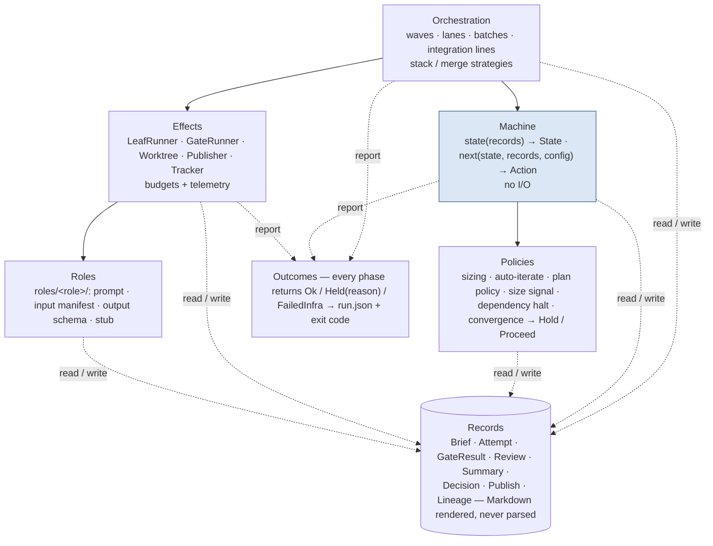
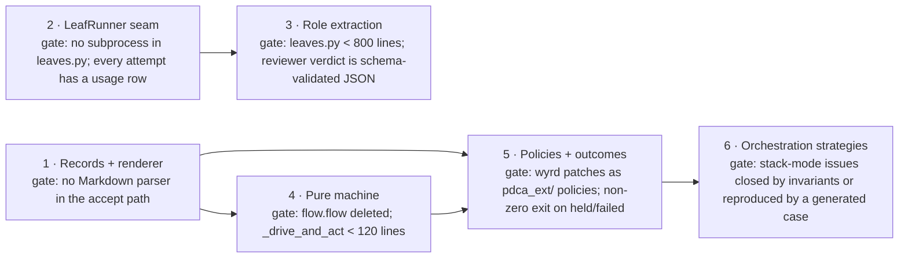

<!-- Proposal 0002, added verbatim from the maintainer's document of 2026-10-15. The only
     edits: the diagrams lost in export ("[embedded content: …]") are redrawn below as Mermaid
     from the surrounding text, and cross-references point at the other proposal's file. -->

# Target architecture and migration order

The gain comes from separating what the harness *knows* (records), what it *decides* (pure transitions and policies) and what it *does* (effects). Today those three are interleaved in `flow.py`, `leaves.py` and `assemble.py`, so a change to any one risks the other two.

> *Diagram redrawn as Mermaid from the text; the original was lost in export.*

Arrows show the only permitted call directions; every layer may read and write records, and no layer reads Markdown. The shaded Machine is the one place the cycle is decided, and it has no I/O.

## The layers

**Records.** One dataclass per bundle artifact — Brief, Attempt, GateResult, Review (11 verdict rows), Summary (findings with id, kind, evidence pointer), Decision, Publish, Lineage — each with `load`/`save` and a schema version. Markdown (`SUMMARY.md`, `brief.md`) is rendered from them and never parsed back. Collapses the #527/#606/#634/#642/#607 bug class to one parser per record.

**Machine.** `state(records) -> State` and `next(state, records, config) -> Action`, no I/O; one loop applies actions. Replaces the `flow.flow` / `flow_ids` pair and makes the transition table testable without disk.

**Effects.** `LeafRunner.run(role, inputs, budget) -> LeafOutcome`, `GateRunner`, `Worktree`, `Publisher`, `Tracker`. Vendors (claude, codex, gemini, stub) are runner implementations; budgets (timeout, turns, dollars) and telemetry (cost, time, memory) live here so every leaf gets them. One fake runner replaces the 122 `subprocess`/`_invoke` patches in the tests.

**Roles.** One folder per leaf: prompt template, input manifest (which records it may see), output schema (fed to `--json-schema` / `--output-schema`, validated at the boundary), stub output. Decorrelation becomes a declared manifest the runner enforces; adding a leaf is adding a folder.

**Policies.** Sizing, auto-iterate eligibility, plan policy, size signal, dependency halt, convergence gate: records in, Hold/Proceed with reason out. A `Policy` protocol discovered from `pdca.toml` or an instance's `pdca_ext/` package — the boundary `copier update` never crosses, and where wyrd's local patches would live.

**Orchestration.** Waves, lanes, batches, integration lines; stack vs merge as a strategy object with stated invariants and property tests over generated dependency graphs. The only route to a smaller stack-mode cluster (#625–#695).

**Outcomes.** Every phase returns Ok / Held(reason) / FailedInfra, written to `run.json` and reflected in the exit code. Contain-and-degrade goes away as a pattern.

## Migration order

A strangler, never a rewrite: each step keeps the suite green and ships as sliced briefs under the size budget.

> *Diagram redrawn as Mermaid from the text; the original was lost in export.*

Each step's gate is the condition in the list below; a step whose gate is not met is not done, whatever its PR count.

1. **Records + renderer.** Write `specs/bundle-format-v1.md` first; introduce the dataclasses and a renderer that conform to it; keep `SUMMARY.md` and `brief.md` byte-identical under golden-file tests; readers switch from Markdown to records one call site at a time. Exit: no `_section_span`, `_OUTCOME_RE`, `_needs_human_rows` or `_FIELD_RE` call remains in the accept path.
2. **`LeafRunner` seam.** Wrap `_invoke` behind the protocol; move the 122 test patches to one fake runner; add `timeout`, `max_turns`, `max_budget_usd` and cost/time telemetry in the runner. Exit: `leaves.py` has no direct `subprocess` use and every attempt has a cost row.
3. **Role extraction.** Move each leaf's prompt, stub and inputs into `roles/<role>/`; introduce the input manifest and output schema; reviewer first (it already has the sandbox contract), builder last. Exit: `leaves.py` under 800 lines; reviewer verdicts arrive as schema-validated JSON.
4. **Pure machine.** Make `driver.advance` I/O-free, collapse the two drivers, and generate the transition table test from the state diagram. Exit: `flow.flow` deleted; `_drive_and_act` under 120 lines.
5. **Policies + outcomes.** Extract the six policies behind the `Policy` protocol with instance discovery; replace `_isolate` and `except Exception: pass` with typed outcomes and `run.json`. Exit: wyrd's local `src/` patches re-expressed as `pdca_ext/` policies; `pdca flow` exits non-zero on a held or failed bundle.
6. **Orchestration strategies.** Stack and merge modes as strategy objects; property tests over generated DAGs for carry, fold and revert. Exit: the open stack-mode issues are either closed by the invariants or reproduced by a generated case.

Steps 1 and 2 are independent and can run in parallel lanes; 3 depends on 2; 4 on 1; 5 on 1 and 4; 6 on 5. The test migration is the main cost — most of the 49k lines are coupled to module shapes, not behaviour — and should be budgeted as its own line in each step's brief.

## Sequencing against the milestones

The switch is a re-sequencing of the \~100 open issues, not a pause. Three milestones get an enabling step as their first bundle; nothing else stops.

| Milestone | Open | What it is today | Enabling step | What to do with its issues |
| --- | --- | --- | --- | --- |
| 0.60 | 18 | stack-mode cluster (#625–#630, #653, #654, #671–#673, #693–#695) | none — finish as is | these are the invariants step 6 needs; write each fix's invariant down as you go |
| 0.61 | 33 | leaf, handoff and flow edge cases; §6 parser bugs (#606, #608, #634, #642, #644) | **2 LeafRunner seam** | fix the leaf and handoff bugs behind the seam; move the five parser bugs to 0.62 to land with records unless one hurts daily |
| 0.62 | 12 | wave semantics, crash-resume (#509), signal deaths (#510), sweep | **1 Records + render** | #509/#510 are the first `Ok / Held / FailedInfra` cut; #499 waits for step 4 |
| 0.63 | 8 | driver guard (#471), diagnostics (#514), reviewer sandbox seed (#586) | after 1 and 2 | #514 is trivial once runner telemetry exists; #586 is a role input manifest |
| 0.64–0.66 | 18 | interactive leaves, remote control, planner contract (#487–#493, #640, #641, #643, #656) | **3 Role extraction** before 0.65 | after step 3 these are folder changes, not `leaves.py` edits |
| 0.67 | 5 | caps and size-signal tuning (#544, #556, #594, #645) | **5 Policies** | implement them as `Policy` instances, not driver code |
| 0.70 | 13 | #505 restructure, #607 Markdown state, #601 prompt skeleton, #512, #551, #535 | **4 + 6** | already the target-architecture milestone; its exit gate is "steps 4–6 closed"; #607 and #601 move forward to where steps 1 and 3 land |

Order: finish 0.60 → 0.61 opens with step 2 → 0.62 opens with step 1 → 0.63 → step 3 before 0.65 → step 5 as 0.67 → 0.70 is steps 4 and 6. Instances stay pinned at v0.59 until the step-1 renderer passes byte-identical golden tests on wyrd's 141 live SUMMARYs.

## Formal structure for the harness itself

pdca-harness should carry the same four document classes it already gives every rendered project through pdca-project-template: specs, architecture, ADRs, proposals. Today the harness has the walkthrough (`docs/00–07`), the vendored spec (`template/PCDA/quality-cycle/00–10`) and issue archaeology in docstrings — but no record of *why* the driver is shaped as it is, so the same debates reopen in issues (#505 and #607 are both re-deriving decisions the code already embodies).

**Layout.** `docs/design/` in pdca-harness, with the four classes and the templates copied from pdca-project-template; `docs/` keeps the walkthrough as the applied guide; `template/PCDA/` stays the single source of the spec and is class 1 by reference, not by copy.

| Class | Harness content | Where it comes from |
| --- | --- | --- |
| Specifications (`specs/`) | the quality-cycle model 00–10; **the bundle document format** (below); the gate marker protocol; the role output schemas (step 3) | spec exists; record and schema specs are written as steps 1 and 3 land, one spec before the second consumer |
| Architecture (`architecture/`, arc42) | 01 goals ← `docs/00`; 02 constraints (stdlib-only, Python ≥ 3.11, Copier, two vendor CLIs); 03 context ← `INTEGRATION.md` contract; 04 solution strategy ← the layer diagram above; 05 building blocks ← the six layers; 06 runtime ← the state machine; 07 deployment (render, `copier update`, instances, `pdca_ext/`); 08 crosscutting ← `docs/07`; 09 build order ← the roadmap above; 10 quality, risks ← the Weaknesses section of this review | written once at the start of step 1, then kept current: a PR that changes structure updates it, enforced by a `T2-docs` gate the way wyrd enforces docs currency |
| ADRs (`adr/`) | see the seed list below | backfilled first, then one per migration step |
| Proposals (`proposals/`) | the oversized-slices, backlog-reversal and re-slicing documents already written in wyrd-pdca; the restructure outline (#505); this review's improvement list | moved out of issues and instance `docs/` into the proposal lifecycle (draft → accepted → implemented) |

**The bundle document format is a spec, and it comes first.** Today the shape of `brief.md`, `SUMMARY.md`, `check-gates.json`, `signoff-decision`, `deferred-findings.json`, `loop-telemetry.json` and the lineage records is defined in three places that can disagree: the prose of spec doc 02 (cycle artifacts), the `templates/*.tpl` files, and the parsers in `assemble.py`, `signoff.py`, `state.py` and `autoiterate.py`. Every consumer — the driver, four role prompts, the instances' `run-verify.sh` and `scripts/review-branch`, the Act index, a human reading §6 — codes against whichever of the three it happened to read. That is the condition the project template's own rule names: write a spec before a second consumer depends on the format. Here there are a dozen.

So step 1 is reordered: the spec is written first, as `specs/bundle-format-v1.md` in RFC 2119 language, and the records, renderer and parsers are then made to conform to it, with the golden set as the conformance suite. The spec covers:

- the bundle layout and the file-derivation of state (which files exist ⇒ which state), as a normative table;
- `brief.md`: the field set, which fields are REQUIRED at Plan exit (Slug, Defect, Success criterion, Scope, Repo + branch target — #580), the carry-forward block grammar, and the maximum size;
- `SUMMARY.md`: the ten sections, the §6 row grammar (id marker, kind, evidence pointer, checkbox), the §9 decision grammar, and the rule that §6 is identified by its last heading;
- the JSON records — `check-gates.json`, `signoff-decision`, `deferred-findings.json`, `loop-telemetry.json`, `publish.json`, lineage — each with a `format` version field and the fields a consumer MUST write and MAY read;
- the gate marker protocol (rc 0 / 77, `PDCA-UNVERIFIABLE:`, `PDCA-DEFERRED:`, `PDCA-EVIDENCE:`, the 120-character path line) as the contract instance gate scripts are written against;
- the decision token set (`accept`, `iterate-do`, `iterate-plan`, `discontinue`) and the C6 refusal rule.

The spec is versioned independently of the template (`bundle-format: 1` in every record; a template release names the format version it reads and writes), so an instance can tell a format change from a driver change, and a frozen bundle from v0.59 stays readable by the step-1 renderer. Spec doc 02 is reduced to the model-level description and points at the format spec for anything a parser depends on; `templates/*.tpl` become renderer fixtures that are tested against the spec rather than a second definition of it.

**Seed ADRs.** The first eight record decisions already made, dated to the issue or commit that made them; the rest are the migration decisions and are written as each step's first PR.

| ADR | Decision | Status |
| --- | --- | --- |
| 0001 | Record architecture decisions (Nygard-style, append-only) | backfill |
| 0002 | Apache-2.0 and DCO | backfill (exists in the project template) |
| 0003 | Bundle state is derived from which files exist; no database | backfill |
| 0004 | No model writes §9; `accept` is refused while a NEEDS-HUMAN item is open (C6) | backfill |
| 0005 | Reviewer is a different vendor from the builder and never sees `build-notes.md` (#419 disposable target) | backfill |
| 0006 | Red-before/green-after is the only evidence allowed to block a sign-off | backfill |
| 0007 | Distribution is a Copier template; instances concretize in `INTEGRATION.md` and `pdca.toml` and update with `copier update` | backfill |
| 0008 | The driver is pure stdlib, Python ≥ 3.11 | backfill |
| 0009 | The bundle document format is a versioned spec (RFC 2119); Markdown artifacts are rendered from typed records that conform to it and never parsed back | step 1 |
| 0010 | Leaves run behind a `LeafRunner` protocol; vendors are implementations; budgets and telemetry live in the runner | step 2 |
| 0011 | A role is data: prompt, input manifest, output schema, stub | step 3 |
| 0012 | One driver; transitions are pure functions over records | step 4 |
| 0013 | Policies implement a `Policy` protocol discovered from `pdca.toml` or an instance's `pdca_ext/`; `copier update` never crosses that boundary | step 5 |
| 0014 | Every phase returns `Ok / Held / FailedInfra`, recorded in `run.json` and the exit code | step 5 |
| 0015 | Integration modes are strategy objects with stated invariants and property tests | step 6 |
| 0016 | The migration is a strangler; instances pin a template version until golden parity | now |

**Process rules that make the structure live.**

- A migration step's first PR carries its ADR; the step is not open until the ADR is Accepted.
- A PR that changes a layer boundary, a record format or a role contract updates `architecture/` in the same PR; the docs gate fails otherwise.
- An Act delta that changes architecture (not just a gate or a brief field) is filed as a proposal, and its acceptance produces an ADR — so the Act loop feeds the decision record instead of the docstrings.
- Instances keep their own `docs/design/` for instance decisions (wyrd's intake cap, track rules); harness ADRs are referenced by number from there, never copied.
